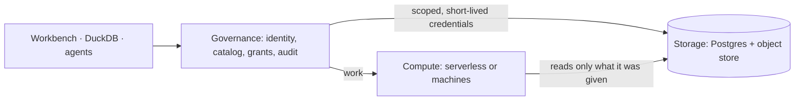

<p align="center">
  
</p>

<h1 align="center">Loamz Data</h1>

<p align="center">
  <b>Governed data platform for Data, AI/ML engineers.</b><br>
  Built on Open Data Format.
</p>

<p align="center">
  <a href="docs/ARCHITECTURE.md">Architecture</a> ·
  <a href="docs/life-of-a-query.md">Life of a query</a> ·
  <a href="docs/CONTRIBUTING.md">Contributing</a> ·
  <a href="docs/rfcs/">RFCs</a> ·
  <a href="specs/data/v1/openapi.yaml">API</a>
</p>

<p align="center">
  
</p>

<p align="center">
  
  
  
  
  
  
  
  
</p>

## Features

- **Governed catalog**: catalogs, schemas, tables and volumes with Unity Catalog privileges and a tamper-evident audit.
- **Open tables**: Apache Iceberg on Parquet in your object store; any Iceberg client reads them through our catalog.
- **SQL and jobs on any compute**: serverless, or your own machines running each job in a gVisor sandbox.
- **Agents act as the person**: an agent gets only what both it and its person may do.
- **Workbench**: catalog, SQL editor, query history, compute and settings in the browser.

## Getting started

```sh
docker compose -f deploy/dev/compose.yml up -d    # Keycloak and Postgres
deploy/dev/seed.py                                 # people; passwords in .dev/accounts.json
cargo build --release -p loamz-data-server
scripts/dev.sh                                     # open http://localhost:5180 and sign in as ana
```

Storage settings (Cloudflare R2) are in [CONTRIBUTING](docs/CONTRIBUTING.md).

## Use it from DuckDB

```sql
INSTALL iceberg; LOAD iceberg;
ATTACH 'nyc' AS lz (TYPE iceberg, ENDPOINT 'http://127.0.0.1:8020/api/v1/workspaces/<id>/iceberg', TOKEN '<token>');
SELECT count(*) FROM lz.main.yellow_trips;
```

`deploy/dev/token.py ana` prints a token. You see only what you may see.

## How it works



Governance decides, storage keeps the bytes, compute runs the work. More in [ARCHITECTURE](docs/ARCHITECTURE.md).

## Development

`make check` runs formatting, lints and tests. Setup, Postgres and sandbox tests: [CONTRIBUTING](docs/CONTRIBUTING.md).

## Status

Under development, not production ready.
