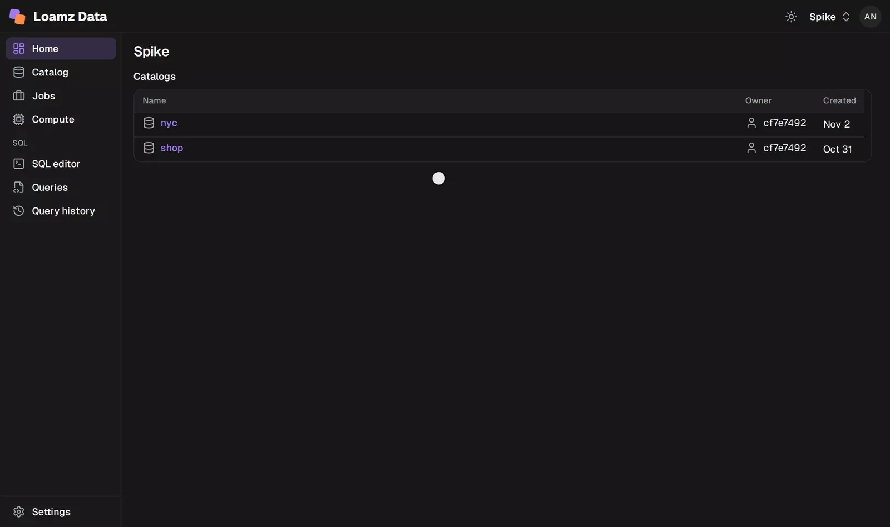
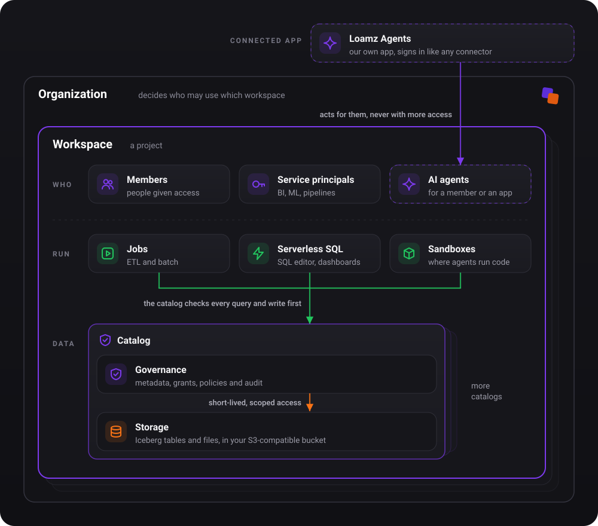

<p align="center">
  
</p>

<h1 align="center">Loamz Data</h1>

<p align="center">
  <b>A governed data platform for analytics and AI.</b><br>
  Built on open table formats, with flexible storage and compute.
</p>

<p align="center">
  <a href="docs/README.md">Documentation</a> ·
  <a href="specs/data/v1/openapi.yaml">API</a>
</p>

<p align="center">
  
</p>

<p align="center">
  
  
  
  
  
  
</p>

## Features

- **Loamz catalog**: tables and files with fine-grained permissions, and an audit log that can't be quietly edited.
- **Open tables**: Apache Iceberg tables in any S3-compatible object store; any Iceberg client reads them through our catalog.
- **Compute for each job**
  - **Jobs**: ETL and batch pipelines.
  - **Serverless**: fast SQL for apps and dashboards, paid only while it runs.
  - **Sandboxes**: AI agents work with your data safely, with only the access they were given.
- **Workspace**: a project with its own people, compute and catalogs, in one interactive console.

## Getting started

You need Docker, Rust and pnpm.

```sh
docker compose -f deploy/dev/compose.yml up -d
scripts/dev.sh
```

Open http://localhost:5180 and sign in as `admin` with password `admin`; you change it on first login. The admin creates organizations and adds people. The same sign-in opens the tools around it: OpenBao (http://127.0.0.1:8200, "Sign in with OIDC Provider") and the RustFS console (http://127.0.0.1:9001, "Login with Loamz").

Data is kept in a local RustFS container. To use your own S3-compatible bucket, change the storage settings in [CONTRIBUTING](CONTRIBUTING.md).

## Use it from DuckDB

```sql
INSTALL iceberg; LOAD iceberg;
ATTACH 'nyc' AS lz (TYPE iceberg, ENDPOINT 'http://127.0.0.1:8020/api/v1/workspaces/<id>/iceberg', TOKEN '<token>');
SELECT count(*) FROM lz.main.yellow_trips;
```

With `deploy/dev/seed.py` run once, `deploy/dev/token.py ana` prints a token. You see only what you may see.

## How it works

<p align="center">
  
</p>

| | |
|---|---|
| **Organization** | Your company. Decides who can use which workspace. People sign in once. |
| **Workspace** | A project: its principals, its compute and its catalogs. A principal is a member (a person) or a service principal (BI, ML apps, pipelines); every action runs under a principal. |
| **Governance** | Decides who can do what, on which thing, across principals, compute, data and storage. Grants, policies and audit. |
| **Catalog** | Schemas of tables (Iceberg), volumes (files), functions and MLflow (ML: experiments, models; GenAI: traces, evals, prompts). Belongs to one workspace. |
| **Storage** | Credentials are long-lived secrets that compute never sees; compute only gets short-lived access scoped to one object. Locations are approved buckets or prefixes; each catalog has one managed root inside a location. Buckets can be shared; default storage needs no setup. |
| **Compute** | Jobs for ETL, serverless SQL, and sandboxes for AI agents. Runs as a principal, asks governance first, then reads and writes the bytes directly. |
| **Apps** | Loamz Agents and connectors. Each acts as a principal, never with more access. |

More in the [architecture](docs/architecture/overview.md) and the [documentation](docs/README.md).

## Development

`make check` runs formatting, lints and tests. Setup, Postgres and sandbox tests: [CONTRIBUTING](CONTRIBUTING.md).

## Status

Under development, not production ready.
