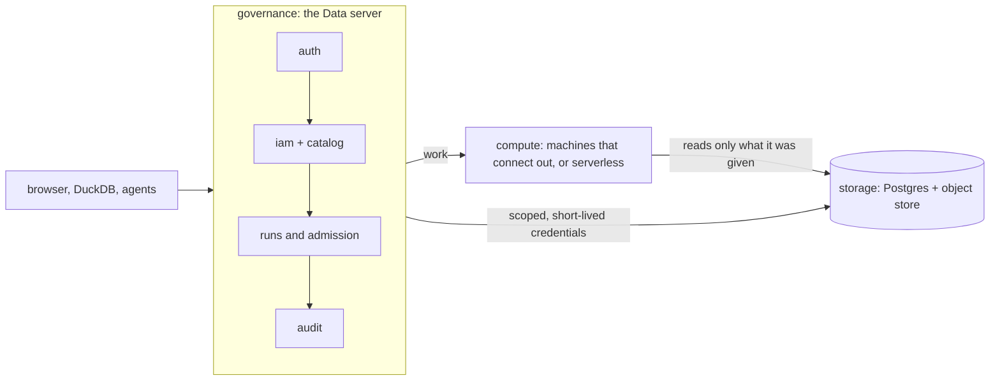

# Architecture

How Loamz Data is built, for the people changing it. What it is and why: [README](../README.md). One query through the code:
[life of a query](life-of-a-query.md). Work in progress: [RFCs](rfcs/).

## Bird's-eye view

Loamz Data is a governed data platform: people, agents and apps keep tables and files in it, and query them with SQL or jobs.
Three parts, and one rule between them: **governance decides, storage keeps bytes, compute runs work, and nothing touches data
without governance's say.**

- **Governance** is the Data server: identity, the catalog, grants, admission, audit. It is also the Iceberg REST catalog.
- **Storage** is a SQL database (Postgres, SQLite in tests) for metadata, and an object store (R2, a folder in tests) for bytes.
- **Compute** runs SQL and jobs: our runner on machines (it connects out; nothing connects in) or a serverless endpoint (Modal).

## Design principles

Speed comes from design, so every change keeps to these, and is measured:
don't move data (send work to it) · read less (prune before reading) · never compute twice (snapshots and files are immutable,
so caches keyed by them are safe) · stay columnar (Parquet at rest, Arrow on the wire) · keep engines warm · keep governance off
the hot path. And for two developers: the smallest change that removes the most work; nothing built "for later".

## Code map

| Path | What lives there |
|---|---|
| `server/lake` | storage library: `sql.rs` (one layer for SQLite and Postgres), `objects.rs` (the `Store`: bucket or folder), `files.rs`, `grants.rs` (short-lived R2 credentials) |
| `server/server/src/kernel` | knows no feature: settings, token check (`auth.rs`), the one `authz::authorize`, errors (problem+json), HTTP, app state |
| `server/server/src/governance` | `audit`, `orgs`, `workspaces`, `iam`, `catalogs`, `lifecycle`; `context.rs` works out what a request is about (`OrgCtx`, `WsCtx`, `FileCtx`) |
| `server/server/src/storage` | `tables` (Iceberg REST catalog: load, commit, credentials) and `volumes` (files) |
| `server/server/src/compute` | targets, runs, admission, the agent protocol (`api.rs`, `service.rs`), SQL checks (`sql.rs`), serverless dispatch (`serverless.rs`) |
| `server/server/src/work` | saved queries |
| `server/runner` | the compute agent: lease, run in gVisor, report |
| `server/serverless/modal_app.py` | the serverless SQL endpoint |
| `web` | the workbench (React) |
| `specs/data/v1/openapi.yaml` | the public API |

Each feature has `model.rs` (pure), `service.rs` (use cases), `store.rs` (SQL) and `api.rs` (HTTP).

## Invariants

Each is enforced by code, and most by a test (in `server/server/tests/` unless named).

1. **Services form one line**: audit < orgs < workspaces < iam < catalogs < volumes < tables < compute < queries < lifecycle; a service
   uses only those before it; `model.rs` files are pure. `layering.rs`
2. **Data depends on nothing else of Loamz**, in Rust or in the web app. `layering.rs::data_depends_on_no_agents_code`
3. **Only `iam` decides access**, through `kernel::authz`. A caller who may not see a thing gets 404, never 403; every refusal is audited.
4. **A change and its audit entry are one transaction** (`audit::service::Uow`); one hash chain per organization. `api.rs::a_change_that_fails_leaves_no_record`
5. **Access is checked again** when a run starts and when its results are read. `compute.rs`
6. **No machine holds the storage key**: a run gets read-only credentials for its tables' folders, for its time limit plus five minutes.
7. **SQL is one plain query** over tables named in full; reading files is refused. `compute/sql.rs` tests
8. **The router and the OpenAPI document agree.** `api.rs::the_routes_and_the_spec_agree`
9. **Every database test runs on SQLite and on Postgres** (the `both!` macro; Postgres when `LOAMZ_TEST_POSTGRES_URL` is set).

## Cross-cutting

- **Identity:** OIDC tokens from Keycloak (`kernel/auth.rs`); an organization is a Keycloak organization alias. A token issued to a
  client in `LOAMZ_DATA_AGENT_CLIENTS` is an agent acting for a person: the pair gets what both may do.
- **Errors:** RFC 9457 problem documents, from `kernel/error.rs`.
- **Long work:** erase and drop are durable tasks in `lifecycle` (lease, retry, verify, audit). Runs are reaped when their lease expires.
- **Admission:** queued and running work is capped per organization with a row lock, so several servers agree.
