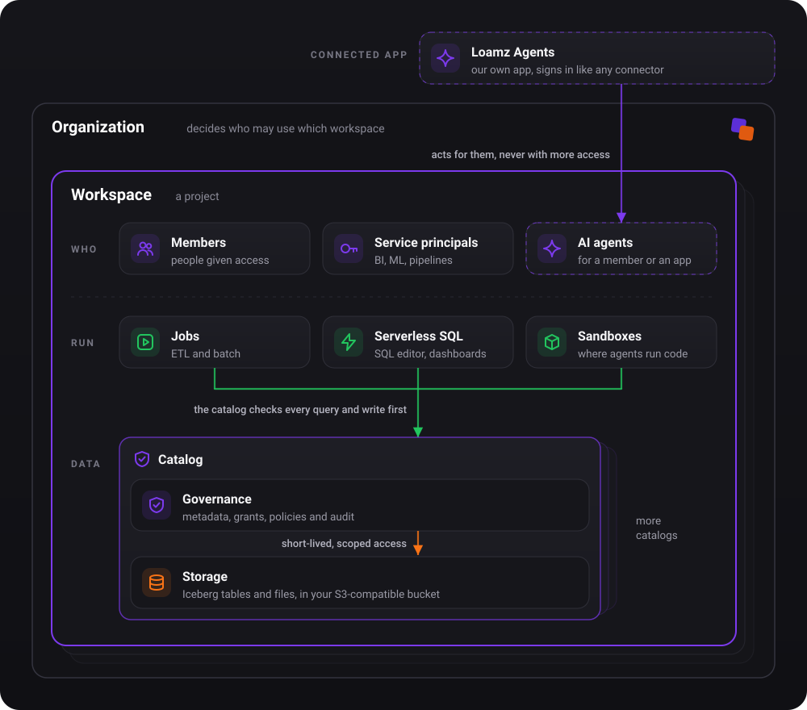
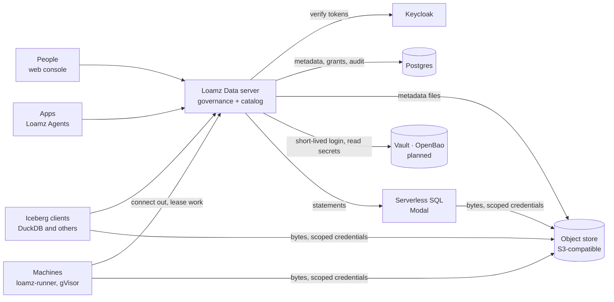
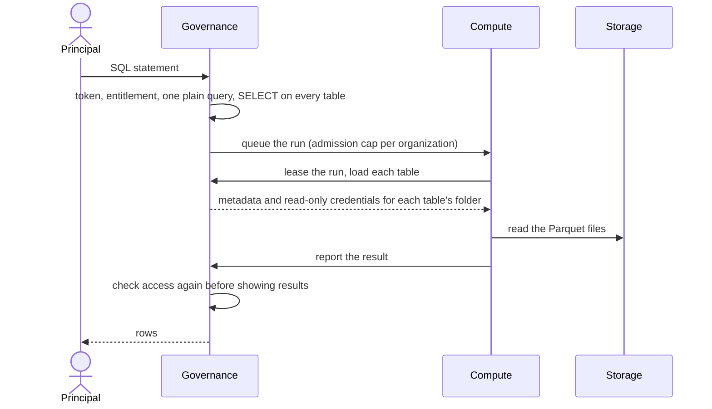
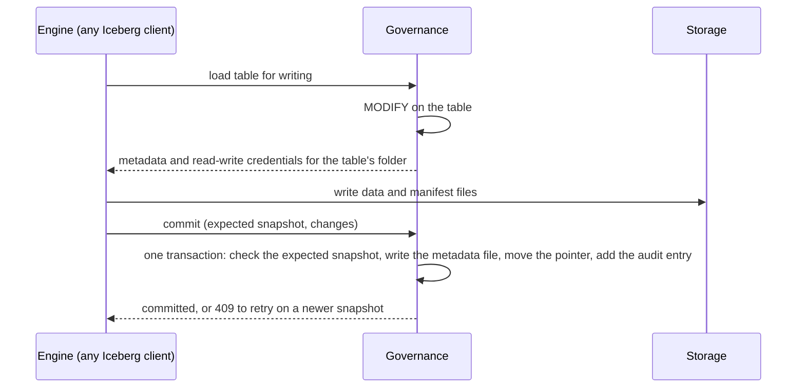

# Architecture overview

How the parts of Loamz Data fit and how work flows through them. What it does: [requirements](../product/requirements.md).
How it runs as a service: [platform](platform.md). Each part in detail: [design](../design/). One query through today's code:
[life of a query](../design/life-of-a-query.md).

## 1. The picture

The picture shows the target design; the [requirements](../product/requirements.md) say what is built today.

**Governance decides, compute does the work, storage keeps the bytes.** Every action runs under a principal. Compute asks governance
first, gets short-lived access scoped to one object, then reads and writes the bytes itself. The catalog never carries data.

## 2. Parts

| part | does | built with | code |
|---|---|---|---|
| Identity | sign-in, organizations, groups | Keycloak (OpenID Connect) | `kernel/auth.rs` |
| Governance | principals, grants, policies, audit; the only place that decides | Rust (axum, sqlx), Postgres | `kernel/authz.rs`, `governance/` |
| Data | the catalog tree, the Iceberg REST catalog, volumes | Apache Iceberg, Parquet | `governance/catalogs/`, `storage/` |
| Compute | runs SQL statements and jobs | DuckDB in gVisor on machines; serverless on Modal | `compute/`, `server/runner`, `server/serverless` |
| Storage | the bytes, and the credentials to reach them | any S3-compatible store (R2 today) | `server/lake` |
| Secrets | every credential and token | OpenBao, read once at start (0002 task 6) | `kernel` settings |
| Web console | catalog, SQL editor, history, compute, settings | React | `web/` |

Paths are under `server/server/src` unless they start with `server/` or `web/`.

## 3. Context

## 4. A read

## 5. A write

Writing bytes and committing them are separate steps: credentials let an engine write files, only the commit makes them part of the
table.

## 6. Rules every change keeps

Each is enforced in code and most have a test in `server/server/tests/`, except those marked *target*: the design guarantees them,
the code does not yet.

1. **Only governance decides**, through `kernel::authz`. A caller who cannot see a thing gets 404; every refusal is audited.
2. **A change and its audit entry are one transaction.** Each organization has its own hash chain.
3. **Bytes never pass through governance.** Compute gets short-lived credentials scoped to one object; long-lived storage
   credentials never leave the server.
4. **Secrets live only in the vault** (*target*, 0002 task 6). The catalog stores a reference; services read a secret with an
   authenticated, short-lived login and hold it in memory only. The server's own login to OpenBao is the one bootstrap secret.
5. **Compute connects out.** The server never connects to a machine; a serverless provider endpoint is the one exception.
6. **Access is checked again** when a run starts and when its results are read.
7. **SQL is one plain query** over tables named in full; reading files is refused.
8. **Services form one line**: audit, orgs, workspaces, iam, catalogs, volumes, tables, compute, queries, lifecycle. Each uses only
   those before it (`layering.rs`).
9. **Data depends on no other Loamz product**; apps are clients of its public API.
10. **The router and the OpenAPI document agree**, and every database test runs on SQLite and on Postgres.
