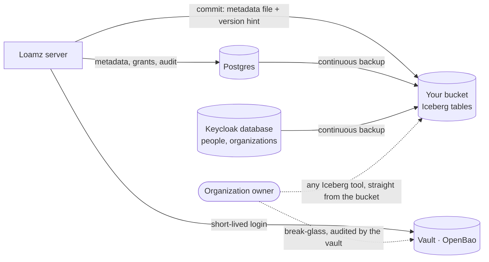
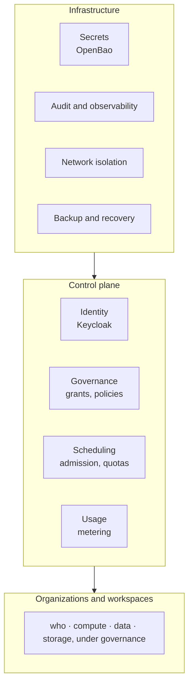
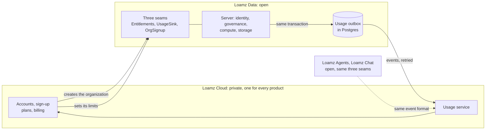
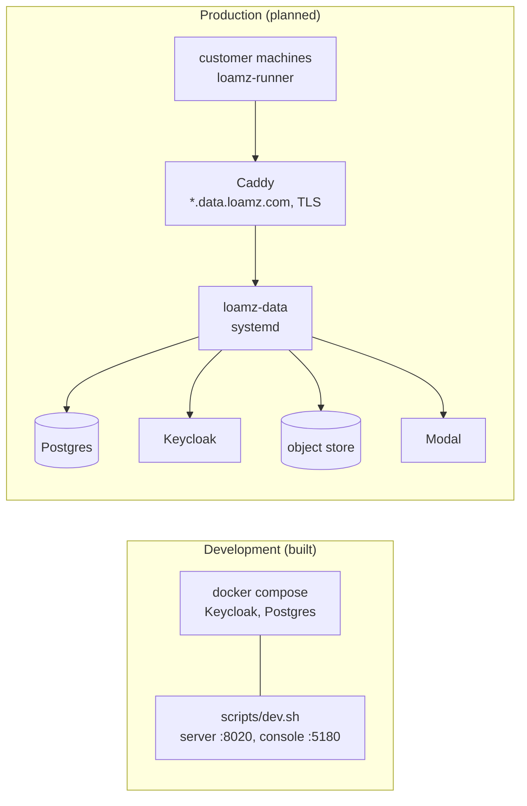

# Platform

How Loamz Data runs as a service: recovery, platform services, hosting and the cloud boundary, deployment, stack and risks. The product's model:
[architecture overview](overview.md).

## 1. When the server is down (planned, 0002 task 6)

Your data never depends on Loamz Data being up.



- **Tables stay readable.** Every commit also writes the table's current metadata location into its folder (Iceberg's
  `version-hint.text`), so any Iceberg tool can read the latest snapshot from the bucket with no Loamz server.
- **Break-glass access.** An organization owner can take the bucket credential from the vault, which runs apart from the server.
  The vault records every use.
- **The catalog comes back as it was.** Postgres is backed up continuously to object storage (WAL archiving) and restored to a point
  in time.
- **Sign-in comes back too.** Keycloak keeps every person and organization in its own database. It is backed up the same way, and
  its realm settings are rebuilt from the template in `loamz-deploy`. Without it nobody can sign in, even with the catalog restored.

## 2. Platform services

The [architecture overview](overview.md) shows the product's model: who, compute, data and storage in a workspace. This is the second view: the services
that run every workspace and keep the platform safe, measured and recoverable.



| capability | today | planned | when |
|---|---|---|---|
| identity | Keycloak (OpenID Connect); machines hold their own secret; jobs carry a scoped job token; apps reach Data by token exchange | federation and MFA: Keycloak supports both; production configuration and enforcement are not yet verified | before production |
| secrets | OpenBao, read once at start and held in memory; development runs it in compose | OpenBao: AppRole login, deny-by-default policies, leases with TTL, an audit device, a three-node Raft cluster, snapshots kept outside it, seal and recovery keys kept apart, a tested restore | before production |
| isolation | compute connects out; each run in gVisor with memory, CPU and process limits; warm workers serve one tenant | all outbound traffic denied by default. Sandboxes reach only the Loamz API: they read data through the query path, never storage. Jobs and serverless reach the Loamz API and only the storage endpoints they were given credentials for. Private networking between services | before production |
| scheduling | an active-run cap per organization; leases, retries, cancellation, reaping | quotas per workspace; sandbox lifecycle (create, idle, stop, delete) | before production |
| audit and observability | a tamper-evident audit chain for every change and refusal; run timings | metrics and traces for every request and run; one view of who read what, with which query | early |
| usage | run timings (`queued_ms`, `run_ms`) | durable usage events per workspace: compute time, bytes read, storage; cost allocation (section 3) | before charging |
| revocation | issued credentials expire with the run (its time limit plus five minutes); access is checked again when a run starts and when results are read | defined behavior when a grant or credential is revoked: new requests refused at once, cached credentials dropped, issued ones left to expire (kept short), running work cancelled when its input access is gone | before production |
| backup and recovery | Iceberg version hints; `scripts/backup.sh` base backups with `scripts/restore-check.sh` proving a restore; break-glass role in OpenBao (policy `break-glass`, one hour, audited) | continuous (WAL) archiving of Postgres and of Keycloak's database, and the same in production (0002 task 6) | before production |
| keys | none | OpenBao transit keys and rotation; an external KMS or HSM for the seal on request | enterprise |

## 3. Hosting and the cloud boundary

One open codebase runs every way. What only a hosted service needs (sign-up, plans, billing) lives outside it, in **Loamz Cloud**:
one private service for every Loamz product (Data, Agents, Chat), so a customer has one account, one organization and one invoice.
Today none of this is built: a development install holds one or more organizations in one Postgres, and the only limit is the
active-run cap.

### 3.1 Ways to run it

Who runs it, and where the bytes and compute are:

| mode | who runs the server, Postgres, Keycloak, OpenBao | bytes | compute | status |
|---|---|---|---|---|
| Development | you, with `docker compose` | R2 today, RustFS planned | your machine | built |
| **Loamz Cloud** | us: many organizations in one Postgres, one `orgs` row each, `org_id` on every table | default storage, or the organization's own bucket | our serverless, or the organization's machines | planned |
| **Self-hosted** | the customer, all of it: the same binary and migrations, deployed with `loamz-deploy`; usually one organization | theirs | theirs | planned, after the beta |
| **Hybrid** | us for the control plane; the customer keeps the bytes and the compute | their bucket, reached through a role in their own account that trusts our server (no long-lived key held by us) | their machines, which connect out: no inbound firewall hole | under consideration |

An organization gets its own Postgres database only on request. Hybrid needs nothing new: compute already connects out and reads
storage directly, so our servers never see the bytes.

What is in the product is a separate question. Everything above is the **core**: complete, never crippled. **Enterprise extras**
(SSO, SCIM, long audit retention) are defined apart from the core and are under consideration.

### 3.2 The boundary



The core talks to the cloud only through three small contracts (traits with a registry, like every strategy in the code). Each has a
default that works with no Loamz account:

| contract | does | self-hosted default | Loamz Cloud |
|---|---|---|---|
| `Entitlements` | gives an organization's limits: active runs, workspaces, compute time, storage | limits the admin sets, plus safety caps (never unlimited CPU, memory or runs) | limits from the subscription |
| `UsageSink` | takes usage events | a durable local table | the same table, delivered to the cloud usage service |
| `OrgSignup` | creates an organization | only the admin, by hand | public sign-up; the cloud creates the organization once and each product makes its row with the same id |

```rust
trait Entitlements { async fn limits(&self, org: OrgId) -> Result<OrgLimits>; }
trait UsageSink    { async fn record(&self, event: UsageEvent) -> Result<()>; }
trait OrgSignup    { async fn create_org(&self, req: OrgSignupRequest) -> Result<Organization>; }
```

### 3.3 Usage events are durable

Billing depends on usage, so an event must never be lost or counted twice.

1. A run finishes. Its usage event is written to `usage_outbox` **in the same transaction** as the change and its audit entry
   (the `Uow`).
2. A sender delivers pending events to the usage service, retrying until each is acknowledged. When no cloud is connected the
   events simply stay in the table.
3. Every event has a unique id; the receiver ignores one it already has. Delivery is at least once, counting is exactly once.

An event: `id`, `org_id`, `product` (`data`, `agents`, `chat`), `workspace_id`, `kind` (`compute_ms`, `bytes_read`,
`storage_bytes`), `quantity`, `at`. The format is a versioned schema shared by all products: they share the contract, not code.

### 3.4 Rules

1. One open codebase for every way of running it.
2. Cloud-only features live outside the data server, in `loamz-cloud`. The core does not know what Stripe is.
3. Billing is never called while a query or run executes. Limits are read from `Entitlements`, cached.
4. `Entitlements`, `UsageSink` and `OrgSignup` are the only seams.
5. A self-hosted install works with no Loamz account.
6. Usage events are durable and idempotent.
7. **The core never needs the cloud to be up to serve work that is already authorized.**
8. Enterprise extras are defined apart from the core, never by removing something from it.

The core is licensed Apache-2.0 (`LICENSE`); the private cloud layer is not part of it. Open: contributor terms (a CLA or DCO), to be settled before outside contributions.

## 4. Deployment



The console is served as two kinds of site from one build: the account site, and one site per workspace (`w-<id>`). Production
needs wildcard DNS and TLS, and the server serving `web/dist`. Deploy scripts live in `loamz-deploy`.

## 5. Stack

| part | used for |
|---|---|
| Rust (axum, sqlx, object_store) | the server and the runner |
| Apache Iceberg, Parquet | table format and files; this server is the Iceberg REST catalog |
| DuckDB | runs SQL and writes tables, in the sandbox or on serverless |
| PostgreSQL (SQLite in tests) | catalog, grants, runs, audit |
| S3-compatible store (Cloudflare R2 today; RustFS planned) | the bytes |
| Keycloak | sign-in; an organization is a Keycloak organization |
| OpenBao (planned) | secrets |
| gVisor | the sandbox for each run on a machine |
| Modal | serverless SQL |
| React, Tailwind, Radix | the web console |

## 6. Constraints and risks

| risk | effect | answer |
|---|---|---|
| one Postgres, one region | an outage stops everything | backups now; a replica when there are customers |
| RustFS's STS is young (session policies) | vended credentials may fail | test it first (0002 task 1); R2's own API stays |
| agent sandboxes need a query path into gVisor | the design is unproven | a spike before building (proposal 0001, sandboxes) |
| the vault is down | no new credentials can be issued | issued ones work until they expire; the server caches secrets in memory; a highly available vault later |
| serverless costs per second | idle cost | stops when idle; only an admin starts it |
| two developers | scope creep | a proposal and a benchmark before anything big |
