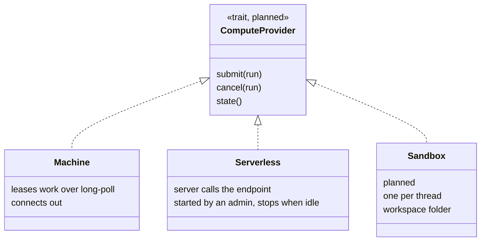
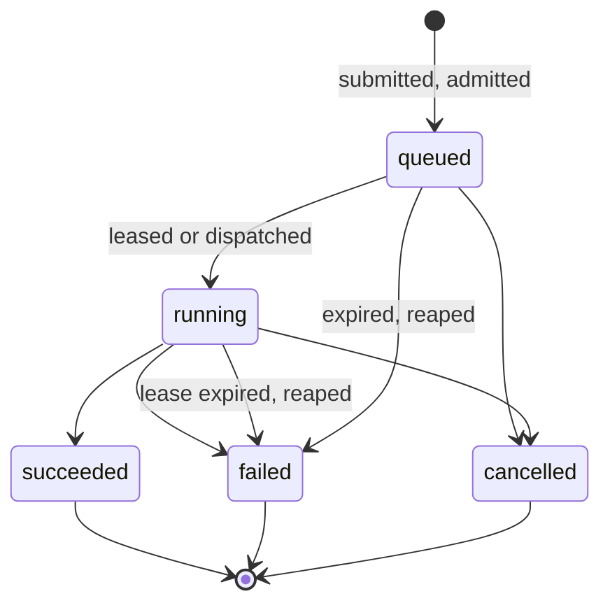
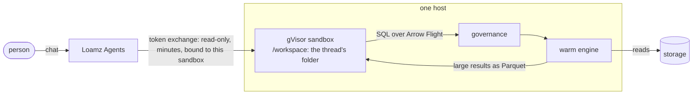
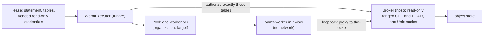

# Design: compute

Where work runs. The system around it: [architecture](../architecture/overview.md). What it may read: [governance](governance.md).
Code: `compute/` (targets, runs, admission, the agent protocol, serverless dispatch), `server/runner`, `server/serverless`.

## 1. Kinds

| kind | runs | where | status |
|---|---|---|---|
| Jobs | SQL statements and jobs (ETL, training, evals) | machines running `loamz-runner`, each run in a gVisor sandbox | Built |
| Serverless SQL | SQL statements, for the SQL editor and BI | a provider endpoint (Modal), pinned near the bucket | Built |
| Sandboxes | an agent's code, one sandbox per conversation thread | gVisor with a workspace folder | Planned |

## 2. Contract

One contract, one implementation per kind, chosen by a registry from the target's kind (the strategy pattern). Today the kinds are
`agent` and `serverless` in `compute_targets`, with a branch per kind; the trait replaces those branches when sandboxes arrive.

## 3. A run

- **Admission:** queued and running work is capped per organization (`LOAMZ_DATA_MAX_ACTIVE_RUNS`, default 32). The count is taken
  under a row lock, so several servers respect one cap. Over the cap is 429.
- **Choosing compute:** the target asked for, else the first running one large enough; machines before serverless. A stopped
  serverless target answers 409 "Start it first".
- **Access again:** the run's inputs are checked when it starts and when its results are read. If access is lost, history keeps the
  status and timings but hides the results.

## 4. Machines

A machine runs `loamz-runner agent`. It connects out and long-polls for a lease; nothing connects in. It holds only its own secret,
shown once and stored as a hash. Each run:

1. gets credentials for exactly its tables' folders, read-only, valid for its time limit plus five minutes;
2. runs in gVisor, with memory, CPU and process limits written into the sandbox's own configuration and checked before it starts;
3. reports its result, logs and timings.

## 5. Serverless SQL

The server calls the provider's HTTPS endpoint with the statement and scoped credentials. It takes SQL only, over data classified
`normal`. An admin starts it; it stops itself a minute after its last call. It is pinned to the region nearest the bucket, because an
Iceberg read is several round trips.

## 6. Sandboxes for agents (planned)

We own the planner, the compute, the catalog and the sandbox, so an agent gets a built-in path to data, not a tool call over HTTP.

- **Sandbox:** stateful. gVisor plus one mounted **workspace** folder per thread (read-write, quota); everything else read-only, `/tmp` in memory. The person can upload files into it, and download what the agent generates. Agents never write tables.
- **Data is queried, not mounted or downloaded.** The agent calls the `loamz` SDK, which sends SQL over Arrow Flight. Governance checks the person and the agent, applies column masks and row filters when it plans the statement, audits it (thread, rows, bytes, result hash) and runs it on the warm worker next to the store. Only the answer moves.
- **Results:** small ones come back as Arrow, which DuckDB, Polars and pandas read without copying. Large ones the worker writes as Parquet into the thread's workspace on the same host (a file hand-off, not a transfer), so they never pass through the model's context.
- **Access:** the sandbox holds no storage credentials and reaches only the Loamz socket or API. The token is read-only, short-lived, and only that sandbox can use it. Per-thread budgets (rows, bytes, CPU) go through the same admission as other runs.
- **Speed:** the same worker, file index and caches as the SQL editor (proposal 0001, tasks 2 to 6). Results are cached by table snapshot, and shared between users only when the policy is the same.
- **Away from the host:** the same protocol works over the network when a sandbox runs on another machine; only the file hand-off becomes a transfer.
- **Workspace lifetime:** the sandbox is disposable and the folder is the state, kept between turns and deleted with the thread. One machine first, so a local directory, checkpointed to the store when idle. NFSv4 if workspaces must be live on any worker.
- **To decide:** how long an idle workspace is kept, and how big one may be.

## 7. Speed (proposal 0001)

### The warm worker (built, 0001 task 2; numbers in `bench/README.md`)

A SQL statement on a machine no longer starts a sandbox and downloads the table. The agent keeps **one warm worker per
(organization, compute target)** inside the same gVisor sandbox as before, and sends it each statement over a pipe.

- **Isolation is the same as for a one-shot run, and one more thing.** The worker has no network, no host files and no other
  organization's data. It serves one organization only; a different organization gets a different worker. Every statement runs on a
  **fresh DuckDB connection** (so one statement cannot see another's temporary tables or secrets), locked down before it runs:
  no local files, only the lease's folders as allowed paths, no extension loading, configuration locked.
- **The worker never holds a key.** The credentials of a lease go to a *broker* in the agent, not into the sandbox. The broker
  accepts only `GET` and `HEAD` for the lease's table folders, honours byte ranges and `If-Match`, counts bytes, and is cleared when
  the run ends (a request in flight is cut off). The worker reaches it through one mounted Unix socket and a loopback bridge, because
  DuckDB speaks HTTP.
- **Reading less.** DuckDB reads Iceberg and Parquet by range through that broker, so a query that needs one column of a few row
  groups no longer downloads the folder.
- **When the warm worker is wrong, it dies.** A protocol error, a timeout, a cancel or a sandbox error removes that worker; the next
  statement starts a fresh one. Workers are also recycled after a number of runs or when idle. Jobs (arbitrary Python) still use the
  one-shot sandbox.
- **Row filters and masks** are already in the statement text when it arrives (section 7 of governance), so the warm worker needs
  no knowledge of them.

### Still planned

Results stream as Arrow (0001 task 3); files are pruned with the `data_files` index (0001 task 4); waits use notifications instead of
polling (0001 task 6).
