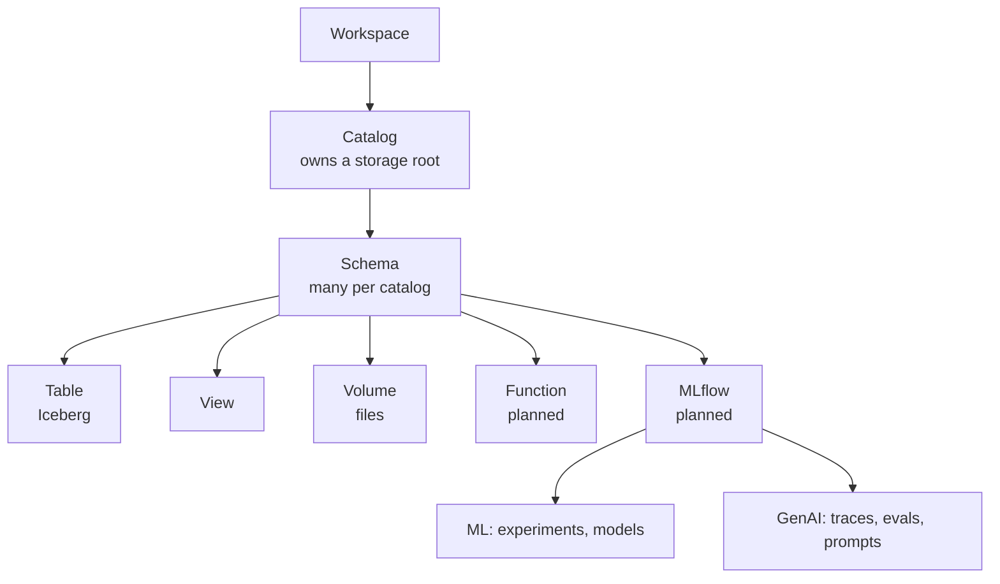
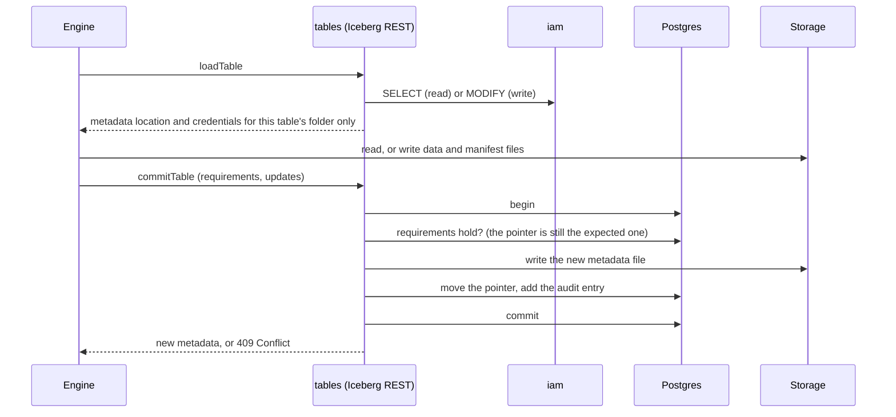

# Design: data

The catalog tree and what lives in it. The system around it: [architecture](../architecture/overview.md). Who may touch it:
[governance](governance.md). Where the bytes live: [storage](storage.md).
Code: `governance/catalogs`, `storage/tables` (Iceberg REST), `storage/volumes`, `compute/sql.rs`, `governance/lifecycle`.

## 1. Model

Every node is a securable: one row in `securables` with its parent, owner, classification and state. Names are unique within their
parent; a table is addressed as `catalog.schema.table`.

| object | holds | status |
|---|---|---|
| table | an Iceberg table: metadata files and Parquet data under its folder | Built |
| view | a stored query | Built |
| volume | files of any format, reached through the API | Built |
| function | SQL or Python logic called from queries; also a tool for agents. Runs in a sandbox under the caller's principal, never in the caller's process | Planned |
| MLflow | ML: experiments and models; GenAI: traces, evals, prompts | Planned |

## 2. Tables: the Iceberg REST catalog

Loamz Data is the Iceberg REST catalog for its tables, at `/api/v1/workspaces/{ws}/iceberg/v1/`. A catalog is an Iceberg
warehouse and a schema a namespace, so any Iceberg client works unchanged (tested with DuckDB).

The pointer (`securables.metadata`) moves only in that transaction, so a table is never seen half-written and every change is
audited.

**Planned (0001 task 4):** at commit, the table's data files and their column statistics go into a `data_files` index in the same
transaction, so a query is planned with one indexed read instead of walking Iceberg's manifests.

## 3. Statements

Before a SQL statement is queued, `compute/sql.rs` parses it. It must be one plain query; every table must be named in full; reading
files is refused. Each table needs `SELECT`. Missing and forbidden give the same 404, so SQL never reveals that a table exists.

## 4. Volumes

A volume is a folder of files under its own prefix. Files are read and written through the API, which checks `READ VOLUME` or
`WRITE VOLUME` and hands out a signed address for exactly one file. A job's own token can reach only the files its run declared.

## 5. MLflow (planned)

The standard `mlflow` client points at Loamz Data, with no custom SDK.

| track | objects | stored as |
|---|---|---|
| ML | experiments, runs, models (versioned) | models through Unity Catalog's model API, which MLflow already supports as a registry |
| GenAI | traces, evaluations, prompts (versioned, with aliases) | traces and evaluation results as Iceberg tables; prompts as catalog objects |

Everything gets the same grants and audit as a table. Traces stored as tables can be queried with SQL.

## 6. Dropping and erasing

Drop and erase are durable tasks in `governance/lifecycle`: leased, retried until done, verified, audited. They are never a
best-effort call.

## 7. Contracts

| contract | pattern | job |
|---|---|---|
| `catalogs::service` | service | create, rename, move ownership, drop; one securable at a time |
| `tables` | Iceberg REST adapter | load, commit, vend credentials, following the Iceberg spec |
| `sql::analyze` | parser and checker | one plain query and the tables it reads |
| `lifecycle` task | durable task (lease, retry, verify) | drop and erase |
