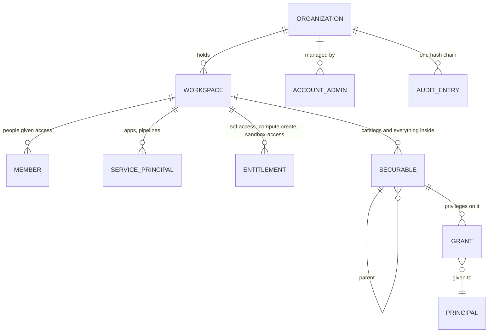
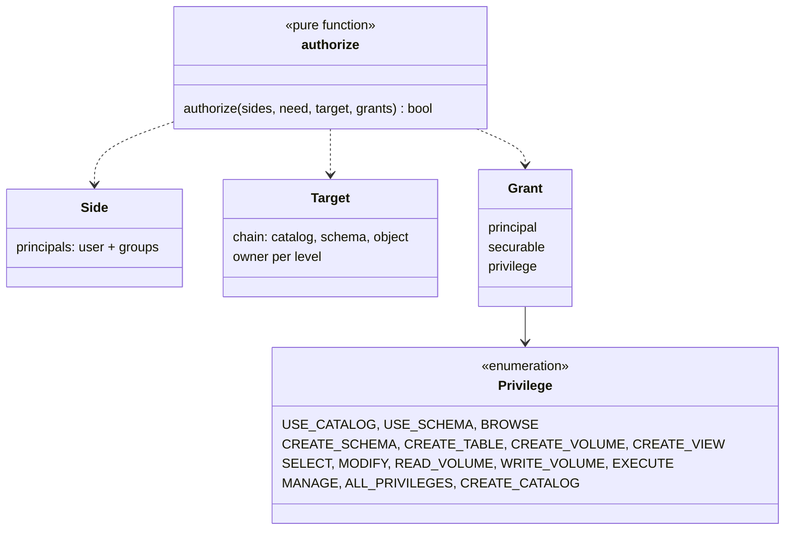
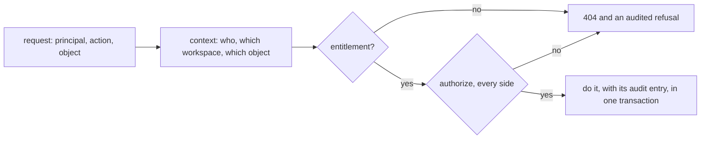
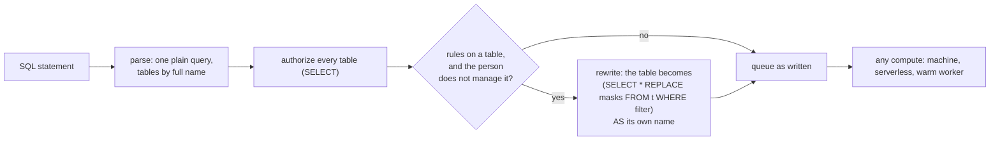

# Design: governance

Who can do what, on which thing, and the record of it. The system around it: [architecture](../architecture/overview.md).
Code: `kernel/authz.rs` (the decision), `governance/iam`, `governance/audit`, `governance/workspaces`, `governance/context.rs`.

## 1. Model

| word | is | stored in |
|---|---|---|
| principal | `user:<subject>`, `group:<path>` or `sp:<id>` (a service principal of the workspace) | grants, members |
| securable | catalog, schema, table, view, volume; (planned) function, model, prompt, credential, location, compute | `securables` (one row each, pointing at its parent) |
| grant | one privilege on one securable for one principal | `grants` |
| entitlement | what a member may do in the workspace at all | `entitlements` |
| audit entry | one change or one refusal, linked to the entry before it | `audit` |

## 2. The decision

`authorize` is pure: facts in, yes or no out. No other code reads grants. Its rules, from Unity Catalog:

1. The **owner** of a securable has every privilege on it and on everything inside it.
2. A privilege granted on a securable **passes down** to everything inside it.
3. Reaching inside a catalog also needs `USE CATALOG`, and inside a schema `USE SCHEMA`. Inheriting `SELECT` does not include them.
4. An **account admin** has everything in the organization.
5. Every **side** must pass. An app acting for a person is two sides, so it gets only what both can do.

## 3. Audit

Every change and its audit entry are written in one transaction (`audit::service::Uow`, the unit of work). Each entry stores the
hash of the one before it, so an organization's entries form one chain; `GET /orgs/{org}/audit/verify` recomputes it. Refusals are
audited too.

Person identifiers in audit actors and explicit person-principal targets are stored as random, organization-scoped refs. The
`audit_names` mapping lets the list API show the subject while it exists, then show `erased person` after the mapping is deleted.
This is a mapping rather than a deterministic hash: hashes are unreadable before erase and can be guessed from known subjects.
Erasure deletes the mapping but never rewrites audit rows or hashes, then records `erase.done` in the same transaction that finishes
the erase task.

## 4. Contracts

| contract | pattern | today |
|---|---|---|
| `authorize(sides, need, target, grants)` | pure decision function | the only place grants are read |
| `iam::require` | gate in front of every service | resolves the target, loads grants, calls `authorize`, audits a refusal |
| `Uow` | unit of work | a change and its audit entry commit together |
| `OrgCtx`, `WsCtx`, `FileCtx` | request context | built once per request from the token and the path |
| `store.rs` per feature | repository | all SQL for that feature, portable across SQLite and Postgres |

## 5. Planned

- ~~Service principals in the workspace~~ — built (0002 task 4): `workspaces/principals.rs`, token `lsp_…` (hash kept), confined to its workspace. One `Principal` type for members, groups and service principals is not done: grants still name them as `user:`, `group:`, `sp:` strings.
- **Grants on compute and storage**: who can use which compute; `READ FILES`, `WRITE FILES`, `CREATE EXTERNAL LOCATION`,
  `CREATE MANAGED STORAGE` (0002 tasks 4, 5).
- ~~Policies~~ — built: row filters and column masks, see section 7.
- ~~Catalogs owned by one workspace~~ — built (0002 task 4): `securables.workspace_id`, migration `0005`; a workspace that owns catalogs cannot be deleted.

## 6. Isolation attacks

The router-level attacks run on SQLite and Postgres in `server/server/tests/adversarial.rs`. Hidden cross-boundary resources return 404;
run tokens that are expired or finished return 401. File-scope refusals are audited by `iam::require`; a resource that is not found in
the caller's scope and a conflicting location do not enter that permission gate.

| attack | test | result |
|---|---|---|
| Read or drop another organization's securable | `foreign_catalog_and_run_ids_are_hidden` | 404; no drop is queued |
| Grant on another organization's securable id | `foreign_catalog_and_run_ids_are_hidden` | 404; no grant is written |
| Read or cancel another organization's run | `foreign_catalog_and_run_ids_are_hidden` | 404; run stays queued |
| Delete another organization's compute target | `foreign_compute_and_storage_ids_are_hidden` | 404; target remains |
| Delete a foreign credential that is in use | `foreign_compute_and_storage_ids_are_hidden` | 404; credential and location remain |
| Use a foreign credential to create a location | `foreign_compute_and_storage_ids_are_hidden` | 404; no location is created |
| Delete another organization's location | `foreign_compute_and_storage_ids_are_hidden` | 404; location remains |
| Rotate or delete another organization's service principal | `foreign_service_principal_ids_are_hidden` | 404; its token still works |
| Open another workspace with an `lsp_…` token | `service_principal_tokens_are_confined_to_one_workspace` | 404 in another workspace, including another organization |
| Read an undeclared volume with a run token | `run_tokens_only_read_inputs_and_write_the_output` | 404; refusal is audited |
| Write or delete an input volume with a run token | `run_tokens_only_read_inputs_and_write_the_output` | 404; bytes remain; refusals are audited |
| Write or delete outside the current run's output folder | `run_tokens_only_read_inputs_and_write_the_output` | 404; another run's files remain; refusal is audited |
| Read the output or use a run token on a non-file route | `run_tokens_only_read_inputs_and_write_the_output` | 404 for output; 401 on a non-file route |
| Reuse an expired or finished run token | `expired_and_finished_run_tokens_are_rejected` | 401; no file is created |
| Escape a volume with `..` or encoded slashes | `volume_paths_cannot_escape_through_dot_segments_or_encoded_slashes` | 404; outside bytes remain unchanged |
| Name a compute target excluded by catalog policy | `a_catalog_policy_hides_a_named_disallowed_target` | 404; no run is queued |
| Change policy after queueing but before lease | `a_queued_run_is_rechecked_against_the_catalog_policy` | no token is issued; run fails closed |
| Overlap another workspace's storage prefix | `overlapping_locations_are_hidden_and_not_created` | 404; no overlapping location is created; a sibling prefix works |

## 7. Row filters and column masks

A table can carry rules written by whoever manages it: a **row filter** (only rows where it is true are visible) and **masks** (an
expression shown in place of a column). Saved with `PUT /workspaces/{ws}/securables/{id}/policy`, `MANAGE` on the table, audited as
`table.policy.set`.

- **A rule is a small expression.** It may use the table's columns, values, comparisons, a short list of plain functions
  (`lower`, `md5`, `concat`, `right`, `regexp_replace`, `coalesce` and a few more), `current_principal()` (the person's name, as in
  grants) and `in_group('name')`. Sub-queries, other table functions and window clauses are refused when the rule is saved. The two
  words about the person are replaced by values when the statement is queued, so compute never sees a function that asks "who".
- **The rewrite is on the server, once.** It is done after authorization and before queuing, so every kind of compute applies the
  rules without knowing about them. The rules apply before anything the person wrote: to `*`, joins, sub-queries and `WITH` alike.
- **Whoever manages the table sees it whole.** Everyone else reads it only through SQL on Loamz compute. A job (which reads raw
  files), an Iceberg client (which would be given credentials to them) and column value ranges are refused for them with a clear
  message, because each would go round the rules.
- **Limits, stated plainly.** Masks hide values, not their existence: a person can still count rows that pass the filter and can
  compare a masked column in a `WHERE` of their own only against the masked value. A person who manages the table can read it
  whole. Rules are not applied to views yet.

