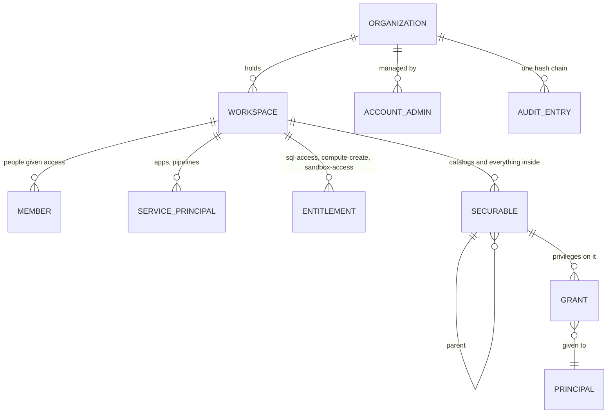
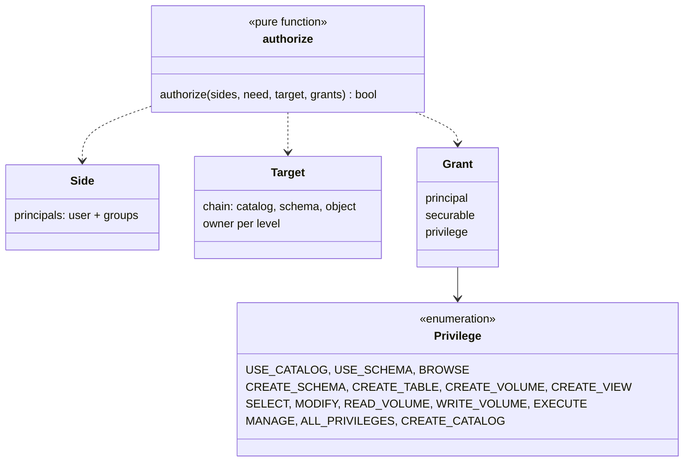
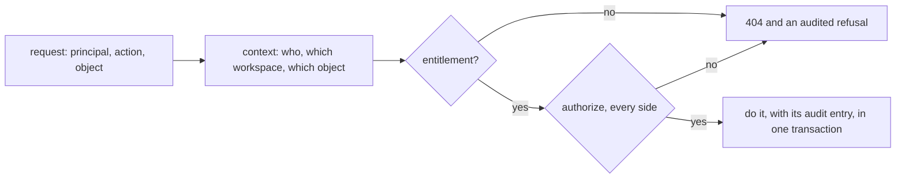

# Design: governance

Who can do what, on which thing, and the record of it. The system around it: [architecture](../architecture/overview.md).
Code: `kernel/authz.rs` (the decision), `governance/iam`, `governance/audit`, `governance/workspaces`, `governance/context.rs`.

## 1. Model

| word | is | stored in |
|---|---|---|
| principal | `user:<subject>`, `group:<path>` or `sp:<id>` (a service principal of the workspace) | grants, members |
| securable | catalog, schema, table, view, volume; (planned) function, model, prompt, credential, location, compute | `securables` (one row each, pointing at its parent) |
| grant | one privilege on one securable for one principal | `grants` |
| entitlement | what a member may do in the workspace at all | `entitlements` |
| audit entry | one change or one refusal, linked to the entry before it | `audit` |

## 2. The decision

`authorize` is pure: facts in, yes or no out. No other code reads grants. Its rules, from Unity Catalog:

1. The **owner** of a securable has every privilege on it and on everything inside it.
2. A privilege granted on a securable **passes down** to everything inside it.
3. Reaching inside a catalog also needs `USE CATALOG`, and inside a schema `USE SCHEMA`. Inheriting `SELECT` does not include them.
4. An **account admin** has everything in the organization.
5. Every **side** must pass. An app acting for a person is two sides, so it gets only what both can do.

## 3. Audit

Every change and its audit entry are written in one transaction (`audit::service::Uow`, the unit of work). Each entry stores the
hash of the one before it, so an organization's entries form one chain; `GET /orgs/{org}/audit/verify` recomputes it. Refusals are
audited too.

## 4. Contracts

| contract | pattern | today |
|---|---|---|
| `authorize(sides, need, target, grants)` | pure decision function | the only place grants are read |
| `iam::require` | gate in front of every service | resolves the target, loads grants, calls `authorize`, audits a refusal |
| `Uow` | unit of work | a change and its audit entry commit together |
| `OrgCtx`, `WsCtx`, `FileCtx` | request context | built once per request from the token and the path |
| `store.rs` per feature | repository | all SQL for that feature, portable across SQLite and Postgres |

## 5. Planned

- ~~Service principals in the workspace~~ — built (0002 task 4): `workspaces/principals.rs`, token `lsp_…` (hash kept), confined to its workspace. One `Principal` type for members, groups and service principals is not done: grants still name them as `user:`, `group:`, `sp:` strings.
- **Grants on compute and storage**: who can use which compute; `READ FILES`, `WRITE FILES`, `CREATE EXTERNAL LOCATION`,
  `CREATE MANAGED STORAGE` (0002 tasks 4, 5).
- **Policies**: row filters and column masks, applied when a statement is planned.
- ~~Catalogs owned by one workspace~~ — built (0002 task 4): `securables.workspace_id`, migration `0005`; a workspace that owns catalogs cannot be deleted.
