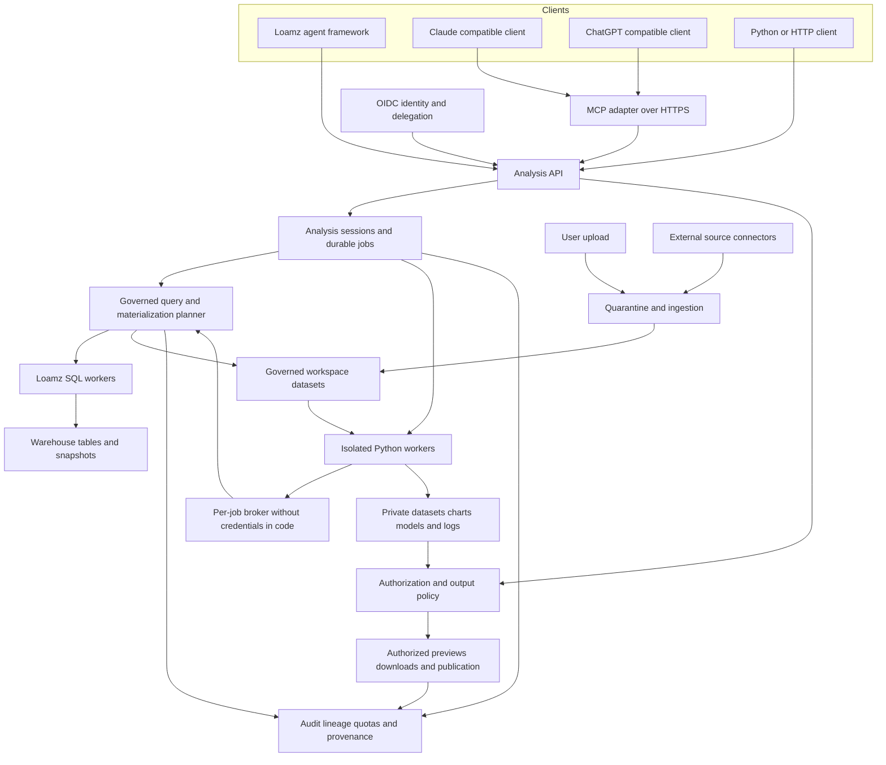

# Governed agent analytics for Loamz

Status: proposed system design, 2026-10-25. Audience: Loamz platform and agent engineers.

Build a model-independent analysis service over Loamz Data. Give agents governed SQL and arbitrary Python execution in isolated workspaces, with uploads, external data, charts, derived datasets and reproducible runs. Expose the service through HTTP, a Python SDK and a thin MCP adapter. Loamz Agents, Claude and ChatGPT should call the same service rather than each implementing data access and execution differently.

**The agent chooses the analysis. Loamz decides what data enters execution and where its outputs may go.** Broad transformation freedom applies to authorized inputs inside an isolated workspace; it does not grant warehouse administration, arbitrary network access or unrestricted disclosure.

## Architecture



The diagram shows logical boundaries. Start with an analysis API deployment, a durable job queue and independently scalable Python workers, reusing the existing data service, catalog, storage and identity provider. Separate every box into a service only when scaling or isolation requires it.

| Boundary | Responsibility | Must remain independent of |
| --- | --- | --- |
| Storage | Immutable table snapshots, uploads and output bytes | Model and chat state |
| Catalog and governance | Names, grants, row filters, masks, labels, lineage and retention | Agent prompts and client UI |
| SQL compute | Authorized query plans and bounded results | Agent orchestration |
| Analysis service | Sessions, code jobs, artifact lifecycle and output checks | Model vendor and Loamz agent scheduler |
| Python compute | Execute untrusted code against authorized inputs | Storage credentials and policy administration |
| Client adapters | Tool discovery, authentication handoff and rendering | Core analytical behavior |

Keep operational job state in the analysis service database. Store governed user data and artifacts in Loamz Data. Do not make the data server depend on the agent runtime; this preserves the existing import contracts.

## Existing foundation and required additions

The current server checkout contains these implementation paths. They establish a starting point, not a production security certification.

| Capability | Current evidence | Design implication |
| --- | --- | --- |
| Governed read-only SQL | [SQL analysis](../../server/server/src/loamz/server/data/features/sql/analysis.py), [planner](../../server/server/src/loamz/server/data/features/sql/planner.py), [policy rewriting](../../server/server/src/loamz/server/data/features/sql/policy.py) | Reuse the planner for all warehouse reads, including materialization and remote code jobs |
| Bounded statement execution and cancellation | [Statement API](../../server/server/src/loamz/server/data/features/sql/api.py) | Extend its identity, audit and budget semantics rather than create another SQL authorization path |
| Credential-free code access | [Gateway](../../server/engine/src/loamz/engine/agents/data/relay.py), [grant wiring](../../server/server/src/loamz/server/agents/bootstrap/data_access.py) | Preserve the host-held token mechanism; extract a neutral broker contract for the independent analysis worker |
| Python data client | [SDK](../../../loamz-python/sdk/python/data/README.md) | Extend the separately owned client repository through versioned HTTP contracts |
| Staged uploads and atomic table ingestion | [Imports](../../server/server/src/loamz/server/data/features/tables/imports.py) | Add quarantine, private analysis scope and additional format handlers around this foundation |
| Generic outbound MCP tools | [Tool server guide](../guides/tool-servers.md) | Currently uses deployment credentials and does not forward individual caller identity; cannot serve as the multi-user analytics identity boundary |
| Efficient analytical data path | [Existing accepted plan](agent-data-path.md) | Retain SQL pushdown and handles; lazy frames, scratch tables and code-to-data work are planned slices there |

New work: independent analysis contracts and workers, governed scratch datasets, artifact lineage and release checks, per-user MCP authorization, safe connector ingestion, and cross-client conformance tests. Existing file and table permissions are building blocks; they do not establish these complete workflows by themselves.

This proposal extends [ADR 0004](../adr/0004-agent-runtime-versus-governed-data.md) and [ADR 0007](../adr/0007-keycloak-identity-and-agent-delegation.md). Some older ADR terminology predates Loamz naming. [ADR 0002](../adr/0002-sandbox-data-transport.md) also contains historical token-file transport; the current gateway code and this design keep credentials outside generated code.

## What freedom means

An authorized analyst can write custom SQL and Python, clean data, join sources, engineer features, fit statistical or ML models, run simulations and generate custom plots. Standard environments include Polars, pandas, NumPy, SciPy, scikit-learn, statsmodels, Matplotlib and Plotly. Record and pin actual package versions in each execution image.

Use two complementary compute paths:

1. **SQL near warehouse storage** for scans, filtering, joins and aggregation. Materialize intermediates server-side and pass opaque handles between steps.
2. **Arbitrary Python in isolated workers** for algorithms and plots that need it. Bring an authorized, size-bounded extract to Python, or schedule a larger worker near the data. Larger inputs require a compute allocation; they do not silently download into a small chat sandbox.

Expose SQL directly from day one. A future lazy DataFrame API can compile common transformations to SQL, but must clearly reject unsupported pushdown operations. Explicit Python materialization is a separate operation with a visible resource estimate. Do not restrict all science to a predefined transformation DSL.

Arbitrary code can encode any input it sees into text, pixels, files or fitted models. Therefore **raw-data Python cannot be promised to produce only safe aggregates through automatic output inspection**. Offer explicit execution policies:

| Policy | Code can see | Outputs may reach |
| --- | --- | --- |
| Authorized analyst | User-authorized rows and masked columns | The same authorized user and explicitly approved model destinations |
| Restricted external model | Only preapproved released data or aggregates | The selected external model and user |
| Internal sensitive analysis | Authorized sensitive inputs in Loamz infrastructure | An authenticated internal viewer; external tools receive status and permitted handles only |

If a source requires aggregate-only disclosure, compute approved aggregates before arbitrary Python receives them. Minimum group sizes alone do not prevent repeated-query inference; use approved query templates or a privacy-budgeted aggregate service where that guarantee is required. Do not advertise arbitrary code on raw inputs as an aggregate-only security boundary.

## Identity and authorization

External MCP clients authenticate with per-user OAuth authorization code and PKCE, backed by the existing IdP where it satisfies the protocol. Publish protected-resource and authorization-server metadata. Verify issuer, audience, expiry, tenant and scopes at every entry point. OAuth linking enables a client to act for a user; it does not grant additional table privileges.

The internal Loamz adapter uses the authenticated run identity and existing delegation foundation. External OAuth tokens terminate at the analysis boundary; trusted services issue narrow internal capabilities instead of passing a foreign token to arbitrary downstream services. Keep all bearer tokens outside Python, prompts, tool arguments and tool results.

Effective permission is the intersection of:

```text
current user privileges
∩ tenant restrictions
∩ client and agent capability limits
∩ analysis session scope
∩ source usage and destination policy
```

Derive tenant and user from verified identity. Never accept an asserted user, tenant, group or owner from model arguments as authority. Bind every session, job, upload, handle and output to the authenticated tenant and owner. Recheck access even when the identifier is unguessable. OAuth scopes constrain actions; resource grants and row/column policies constrain data.

Authorize catalog discovery, descriptions, samples, profiles and statistics as well as queries. Global counts or min/max statistics can disclose rows outside a row filter; use metadata-only answers only when valid for the caller's exact authorized scope. The planner must apply row filters and masks before user predicates, joins and aggregations. Review definer-rights views explicitly: a saved owner's identity or group snapshot must not preserve revoked authority or bypass tenant context.

For scheduled jobs, record an explicit delegated authority, expiry and owner. At dispatch and before releasing results, verify that authority is still valid. A service account with wider rights must not become a substitute when the owner's access expires.

## Analysis sessions and tool contracts

A session is a private workspace for one user within one tenant. It holds dataset references, code revisions, job history and output manifests. A client conversation can reference a session; a conversation ID is never its authorization credential. Resume the same session from another authorized client without copying data.

Use a versioned HTTP contract as the canonical API. MCP and Python SDK methods call the same application services. The following names and routes are proposed, not existing endpoints.

| Tool | Main input | Main result |
| --- | --- | --- |
| `discover_data` | Search terms and permitted filters | Visible dataset identifiers and business descriptions |
| `describe_data` | Dataset identifier | Authorized schema, units, grain, freshness, permitted samples and join guidance |
| `create_analysis` | Purpose and requested limits | Owned session identifier and effective limits |
| `prepare_upload` | Session, filename and declared size | Private upload identifier and transfer instructions |
| `complete_upload` | Upload identifier and integrity metadata | Ingestion job identifier |
| `import_source` | Registered connector and approved source reference | Ingestion job identifier |
| `query_data` | Session, SQL, parameters and result mode | Small preview or governed dataset handle |
| `run_python` | Session, code, explicit input handles and environment | Durable job identifier |
| `get_job` / `cancel_job` | Job identifier | State, permitted diagnostics and output handles |
| `read_artifact` | Artifact identifier and requested representation | Authorized preview, image or download action |
| `publish_dataset` | Derived handle, destination and description | Validated catalog version or required approval |

For example, `POST /api/v1/analyses/{id}/python-jobs` accepts code and input handles and returns `202` plus a job ID. `GET /api/v1/analysis-jobs/{id}` returns progress. This short-submit-and-poll pattern avoids dependence on a client's support for long MCP calls or asynchronous MCP extensions.

Return a consistent envelope: resource ID, state, schema, preview if permitted, truncation indicator, warnings, provenance reference and usage counters. Oversized previews fail with a structured instruction to aggregate or request an authorized artifact. Do not place millions of rows or long-lived download URLs into model context.

Input declarations improve scheduling and lineage, but are not a security boundary by themselves. Every broker read must be authorized and recorded. With unrestricted Python, conservatively label every output with all inputs available to the running process. A persistent interpreter accumulates restrictions across cells; use a fresh worker to obtain a narrower input scope. Cross-user interpreter reuse is forbidden.

## Uploaded and external data

Uploads land in a private quarantine prefix. Enforce declared and actual size, checksums, format detection, decompression limits, parser timeouts, malware scanning and retention. Parse in an isolated ingestion worker. Ignore spreadsheet macros and external links; do not execute formulas. CSV, Parquet and NDJSON can build on current ingestion; Excel requires an explicit safe parser and sheet/type selection workflow.

After validation, register a versioned private dataset with schema, owner, source hash, sensitivity labels and ingestion warnings. Report inferred types, invalid rows, timestamp assumptions and any coercion or rejection counts. An upload does not become shared merely because it was imported into a tenant warehouse.

Other sources enter through registered connectors. Store credentials in a secret manager and fetch them only in connector workers. A connector declares supported resources and permitted network destinations. Authorize both the external source identity and the Loamz destination. Record source version or extraction time, license/usage restrictions and freshness.

For URL sources, constrain schemes, hosts, redirects, resolved IPs, response sizes and timeouts; reject internal addresses and cloud metadata endpoints. Revalidate redirect targets and DNS resolution at connection time. Do not give arbitrary Python an internet connection to fetch external data. If a new package is needed, build a reviewed image from a controlled registry; no unrestricted runtime package installation.

Files, table cells and connector responses are untrusted data. They cannot change policies, grant tools or supply executable instructions. The design assumes prompt injection can occur and enforces access outside the model.

## A complete analysis flow

Example request: “Join my uploaded sales workbook to warehouse products and an approved weather source, explain weekly demand, fit a forecast and produce charts and a cleaned dataset.”

1. Authenticate the user and create a private analysis session with their client destination policy.
2. Quarantine and parse the workbook. Import weather through a registered connector. Register both as private versioned datasets.
3. Discover only accessible warehouse tables. Read schema, units, time zones and supported join keys. Profile authorized samples.
4. Check join cardinality, duplicate keys, missing keys and temporal alignment. Report unmatched coverage and prevent accidental many-to-many multiplication. Treat missing observations separately from zero.
5. Execute the bulk join and aggregation through the governed SQL planner. Save the intermediate as a private dataset with recorded snapshots and effective source restrictions.
6. Run Python against that handle in a worker sized for the data. Use temporal train/test splits for forecasts, record seeds and compare against a baseline. The agent can iterate within its quotas without approval for each transformation.
7. Save charts, evaluation metrics, the cleaned dataset and a reproducibility manifest. Send every output, including logs and errors, through the release policy.
8. Return authorized chart previews and dataset handles. The report names the source metric, period, coverage, exclusions and uncertainty. Publishing a reusable dataset is a separate authorized operation.

## Python execution and isolation

The analysis worker runs code independently of the model's native interpreter. Extract the existing sandbox mechanisms behind a neutral `ExecutionBackend` contract rather than importing agent runtime modules into Loamz Data. The analysis service may be a sibling deployment; shared sandbox primitives belong in a neutral engine package.

Use a fresh filesystem and unprivileged sandbox per job or private persistent session, with a read-only base image, CPU/memory/disk/process limits, wall-clock timeout and no ambient credentials. Do not mount host directories, cloud service-account tokens or container sockets. Restrict system calls and drop capabilities. For hostile multi-tenant workloads, use a stronger boundary such as microVMs or an appropriately hardened sandbox runtime; ordinary containers alone are not the chosen trust boundary.

The network stays closed. A per-job socket connects to a trusted broker that owns a short-lived, audience-bound delegated capability. It accepts only typed analytics operations, drops caller-supplied identity headers, enforces byte/request budgets and records reads. SQL reads still pass through Loamz authorization. Output collection uses a separate scoped channel; adding artifact upload must not expose general file deletion, policy editing or warehouse mutation.

On cancel, timeout or revocation, stop broker access, propagate cancellation to SQL and compute, terminate the worker and destroy scratch storage. Never collect partial files as completed outputs. Workers need heartbeats and leases so crashed jobs can be reconciled and abandoned credentials expire.

## Derived data and artifact governance

All outputs start private. Charts, tables, HTML, logs, exception messages, notebooks and trained models can carry sensitive information. Arbitrary code output inherits the combined restrictions of every input available during execution. Its classification cannot be lowered by renaming columns, aggregating, encoding values or fitting a model.

For each derived resource store tenant, owner, source snapshots, authorized source scopes, policy versions, code hash, image digest, package versions, seeds, job ID, classification, permitted destinations and retention expiry. Labels and provenance are service-written; generated code cannot edit them.

Copying source ACLs is insufficient: row predicates may refer to columns removed by the transformation, and a new reader may be entitled to different rows. Initially allow derived results only to the creator with the same effective source scope. On policy or entitlement changes, block reuse and require regeneration. Cross-user access requires a dedicated sharing decision proving the recipient may receive the materialized scope, or recomputing under that recipient's identity. Unknown lineage fails closed.

The artifact service authorizes every preview and download against current permissions and destination. Use an authenticated proxy when immediate revocation matters. Signed storage URLs are bearer capabilities that remain usable until expiry; if used for permitted transfers, make them short-lived, narrowly scoped and keep them out of model context where possible. Previously downloaded or model-disclosed bytes cannot be revoked.

Export authorization is distinct from permission to compute on data. External-model release also checks the approved provider, workspace/client context where verifiable, region and applicable data-use policy. A model vendor's identity is not a substitute for end-user identity. If policy requires a corporate client workspace and that context cannot be verified, deny that external release and use Loamz's authenticated viewer.

For rendering, provide PNG as the portable baseline. Keep Plotly/Vega specifications and their embedded data governed. Render interactive charts on an authenticated Loamz page with CSP and no external network dependencies; sanitize or isolate generated HTML. Protect spreadsheet exports against formula injection. Content scanning is defense in depth, not proof that arbitrary output is safe.

Publication creates a governed table or artifact version through an explicit API. Require destination creation rights, output policy checks, schema/data-quality validation and an atomic commit. Publishing does not grant source `MODIFY`, relax classification or automatically share with the tenant. Declassification needs a separately authorized process.

## Scale reliability and reproducibility

Push filtering and aggregation to SQL. Use Arrow batches and dataset handles for data transfer; JSON is for previews and metadata. Keep warehouse-scale intermediates near storage. Python workers scale by resource class; long transformations use batch jobs. Add distributed compute only when a single suitable worker is insufficient.

Persist jobs with states `queued`, `running`, `succeeded`, `failed`, `cancelled` and `expired`. Store output manifests before marking success. Use request idempotency keys, attempt identifiers and conditional publication so retries cannot create duplicate visible outputs. A retry of arbitrary code is at-least-once computation; only committed output publication is deduplicated.

Enforce scan bytes, result bytes, CPU time, memory, disk, storage, concurrency and external release budgets per user and tenant. Reserve capacity transactionally before dispatch and reconcile actual usage. Process-local concurrency counters are not sufficient once multiple API replicas accept work. Add fair scheduling, backpressure and explicit resource escalation instead of silent partial results.

Result and execution cache keys include tenant, effective authorization scope and policy version, source snapshots, SQL/code, parameters, environment and relevant seeds. Authorize before any cache hit and again at release. Do not share writable scratch state between tenants. Reproducibility means a recorded execution can be replayed against the same available inputs and environment; model reasoning and unseeded numerical work need not be identical.

Audit authentication, discovery, denied operations, source reads, policy decisions, uploads, code submission, job lifecycle, output release and publication. Correlate user, tenant, client, agent, session, job and query. Store sensitive code/log bodies separately under restricted access; do not indiscriminately copy them into general telemetry. Export security events to an independently protected audit destination.

## Portability across Loamz Claude and ChatGPT

**Use MCP for tools, not as the compute engine or security policy.** The analysis API owns execution and access. Thin adapters expose the same operations, schemas and error meanings. A host that supports only ordinary tool calls can still submit code, poll a job and obtain permitted previews.

| Surface | Shared behavior | Client-specific behavior |
| --- | --- | --- |
| Loamz Agents | Analysis API, SQL policy, Python environment and artifact governance | Native session identity, upload UI, streamed progress and rich viewer |
| ChatGPT compatible MCP connection | Same backend tools through authenticated remote MCP | OAuth connection configuration, enabled tools, attachment handoff and rendering support |
| Claude compatible MCP client | Same backend tools through authenticated remote MCP | Product-specific connection setup, OAuth/token management and rendering support |
| API-based application using either model | Same HTTP/MCP tools and execution environment | Application owns model loop, approvals and per-user token acquisition |

OpenAI's current [MCP server documentation](https://developers.openai.com/plugins/build/mcp-server) supports controlled tools on operator infrastructure, with [OAuth authorization requirements](https://developers.openai.com/plugins/build/auth). Anthropic's [MCP connector documentation](https://platform.claude.com/docs/en/agents-and-tools/mcp-connector) supports remote tool calls through its API, with product-specific transport and authentication requirements. These establish protocol feasibility; deployment must validate the chosen client/account and its configured policies.

Do not assume a file attached to a ChatGPT or Claude conversation is accessible to a remote tool. Use a client-supported attachment transfer where available; otherwise return a secure Loamz upload action and resume with the resulting dataset handle. Never ask the model to invent a local file path or use unrestricted URL fetching as an attachment workaround.

The same tools and policies can be portable. Identical answers, tool choices, native charts and attachment behavior are not guaranteed. Use shared analysis guidance for discover/profile/join/validate/report steps and a common evaluation suite to measure comparable quality. For the closest behavior, use Loamz's UI and orchestration and switch only the underlying model provider.

Expose only the MCP edge to external clients; workers, storage and the warehouse stay private. If external hosted clients cannot reach a permitted edge, use the internal Loamz client. Sensitive data can remain in Loamz compute, but anything returned in tool text, images or structured previews is disclosed to that model provider. Internal computation alone does not prevent that disclosure.

## Delivery sequence and acceptance gates

| Stage | Deliverable | Acceptance gate |
| --- | --- | --- |
| 1 | Versioned analysis API, owned sessions, governed SQL handles and private outputs using existing data primitives | Two users with different row/column rights see the correct distinct results; cross-tenant and forged-handle reads fail |
| 2 | Independent Python workers, durable jobs, uploads and full output lineage | Arbitrary science and plotting work; credentials/network escape tests fail safely; code cannot lower labels; cancellation and crash recovery work |
| 3 | Per-user MCP edge and Loamz adapter against identical application services | Same fixed SQL/code task yields equivalent permitted outputs across clients; shared deployment tokens cannot widen authority |
| 4 | Registered connectors, controlled publication and production resource accounting | SSRF/parser attacks are rejected; retries publish once; policy changes block stale outputs; tenant quotas work across replicas |
| 5 | Larger workers, plot downsampling, additional pushdown and optional distributed execution | Representative workloads meet measured scan, transfer, latency and memory budgets without changing governance |

Before any shared enterprise release, additionally exercise masked-value inference through predicates and joins, view-definer revocation, statistics leaks, cache reuse across scopes, artifacts after entitlement changes, logs containing protected data, malicious chart HTML, cross-session contamination, denied model destinations and attempted publication from partial jobs.

Start with ordinary HTTP plus Arrow IPC, the existing catalog and the current IdP. A Flight endpoint, a custom DataFrame compiler, a new policy engine or a separate distributed compute stack is not a prerequisite. The first complete vertical slice should join one private upload to one governed warehouse table, execute custom Python, return a chart and derived dataset, and demonstrate that a second user cannot read either result without authorization.
