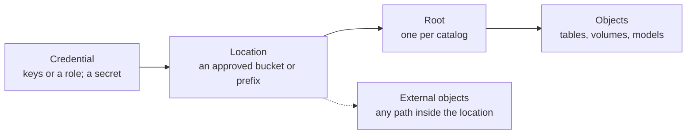
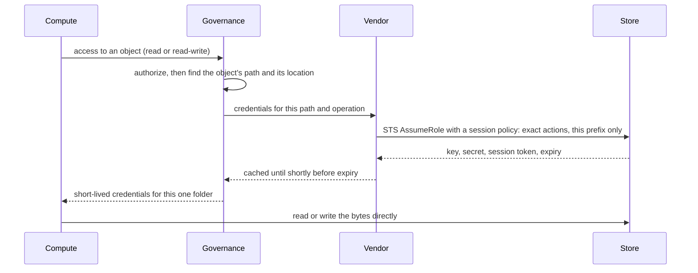
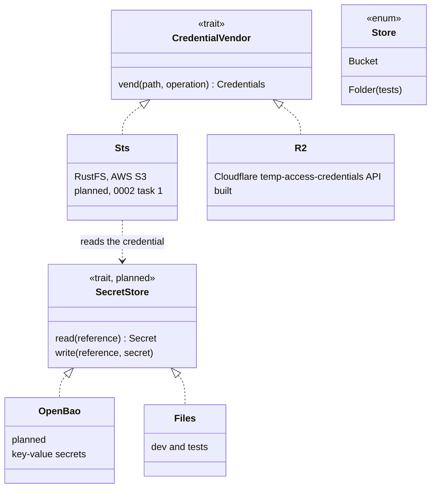

# Design: storage

Where the bytes live and how compute reaches them without holding a key. The system around it: [architecture](../architecture/overview.md).
Code: `server/lake` (`objects.rs` the store, `grants.rs` credential vending, `files.rs` the folder store for tests).

## 1. Model (credentials and locations built; roots, managed and external objects, default storage and storage grants planned: 0002 task 5)

| thing | is | belongs to |
|---|---|---|
| credential | how the server reaches a store: keys or a role. Kept in the vault; the catalog stores only a reference. Never leaves the server. | workspace |
| location | an approved bucket or prefix, using one credential. Locations never overlap. | workspace |
| root | where a catalog's managed objects live, inside a location | catalog |
| managed object | a table, volume or model under its catalog's root; dropping it deletes its files | catalog |
| external object | a table or volume at a path inside a location; dropping it keeps the files | catalog |

A bucket can serve several workspaces through separate prefixes. No object's path may sit inside another object's path, and a path
being deleted is locked.

| grant | on | allows |
|---|---|---|
| `CREATE EXTERNAL LOCATION` | credential | making a location with it |
| `READ FILES`, `WRITE FILES` | location | raw file access under it |
| `CREATE EXTERNAL TABLE`, `CREATE EXTERNAL VOLUME` | location | external objects in it |
| `CREATE MANAGED STORAGE` | location | catalog roots in it |

Each new workspace gets **default storage** on RustFS, so nothing has to be set up (0002 task 3).

## 2. Credential vending

The session policy lists exact actions (`s3:GetObject`, and for writes `s3:PutObject`, `s3:DeleteObject` and the multipart
actions), because some S3-compatible STS servers reject wildcards. It never contains an `Id` element, which RustFS rejects today.

### When access is revoked (planned)

| what | happens |
|---|---|
| new requests | refused at once |
| cached credentials | dropped from the cache |
| credentials already issued | work until they expire, so their lifetime stays short (minutes); a store that supports it revokes them early |
| running work | cancelled if it lost access to an input; results are hidden either way (access is checked again when they are read) |

## 3. Contracts

One contract, one implementation per kind of store (the strategy pattern), chosen by the location's credential. R2 has no STS, so it
keeps its own API. **Iceberg remote signing** (the catalog signs each request; the client never holds credentials) is the fallback for
a store with neither, and for the strictest data. DuckDB needs vended credentials, so they are the default.

## 4. Today

One R2 bucket, `loamz-data`, with one prefix per securable id. The server reads the bucket key and an issuer token from OpenBao at start
(`LOAMZ_DATA_BUCKET_*_REF`, references into OpenBao). A run gets
read-only credentials for exactly its tables' folders, valid for its time limit plus five minutes. A statement on serverless gets
the same; a job's volume files go through the API with the job's own token. A folder store exists for tests only.
