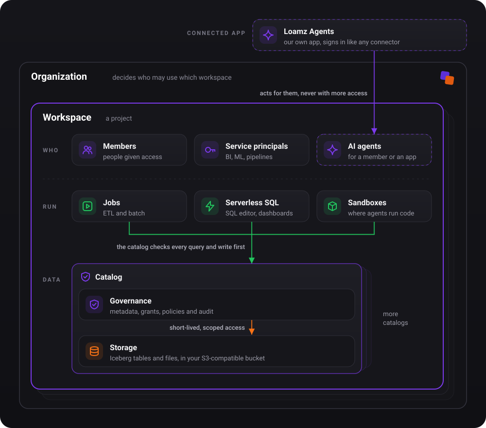

# Overview

Loamz Data is a governed data platform for data and AI/ML engineers, built on open formats: Iceberg tables in your own
S3-compatible storage, one governance for data, ML and GenAI, and compute that reads the bytes directly.

The picture shows the target design; the [requirements](requirements.md) say what is built today.

## Why Loamz Data

- **Your data stays yours.** Open Iceberg tables in your own bucket, readable by any Iceberg tool, even when Loamz is down.
- **One governance for people, apps and agents.** The same grants for SQL, jobs, ML and GenAI, and one audit trail.
- **Compute that fits the job.** ETL jobs, serverless SQL and sandboxes for agents, all on the same tables.
- **Fast by design.** Work runs next to the data, files are pruned before they are read, and bytes never pass through the catalog.

## An example

A sales team keeps `sales.main.orders` in its workspace. Ana, an analyst, runs a dashboard query on serverless SQL. A nightly job,
running as the service principal `etl`, appends yesterday's orders. In the team's chat, an AI agent answers "which region grew
last week?" acting for Ana. All three are checked by the same grants: the agent reads only what both it and Ana can, it never sees a
storage key, and every read and commit is in the audit log. If Loamz is down, the team still reads `sales.main.orders` from its
bucket with DuckDB.

## Who it is for

| who | needs |
|---|---|
| data engineers | ETL and batch jobs that read and write governed tables |
| analysts | SQL over the same tables, from a SQL editor or a BI tool |
| ML and AI engineers | experiments, models, traces, evals and prompts, governed like data |
| AI agents | safe, read-only access to data, for a member or a service principal |
| admins | workspaces, access, storage, limits and a complete audit trail |

## Words

| word | means |
|---|---|
| organization | a company. It decides who can use which workspace. |
| workspace | a project: its principals, compute, catalogs and storage settings. |
| principal | who an action runs under: a member (a person), a group, or a service principal (an app or pipeline). |
| governance | grants, policies and audit over principals, compute, data and storage. The only place that decides. |
| catalog | the top of the data tree: catalog, schema, then tables, volumes, functions and MLflow objects. |
| compute | where work runs: jobs, serverless SQL, sandboxes. It does the work and never decides access. |
| storage | where bytes live: credentials, locations (a bucket or prefix) and one root per catalog. |
| app | software that acts for a principal, such as Loamz Agents. Never more access than that principal. |

## Status

These documents describe the product we are building. Each feature is marked **Built** or **Planned**; a planned one names its
proposal and task. What is next: [roadmap](roadmap.md).
