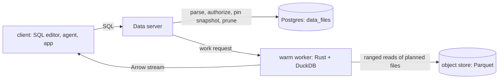

# RFC 001: Fast data plane

- **Status:** accepted, 12 Nov 2026. Task 1 (benchmark) is next.
- **Authors:** Ravikumar, Claude.

## Context

Loamz Data's promise is *fast and governed*. Today a query does far more work than it needs:

| Step | Today | Cost |
|---|---|---|
| Find files | DuckDB walks Iceberg metadata, the manifest list and manifests on R2 | sequential round trips per table |
| Move data | the runner downloads every object of each table first (`runner/src/work.rs::fetch_table`) | the whole table over the network |
| Start | per statement: gVisor, Python, DuckDB, `LOAD iceberg`; Modal cold start | hundreds of ms to seconds |
| Execute | DuckDB with `threads=1` | one core |
| Return | each value turned into JSON in Python, capped at 3.5 MB | slow, small results only |
| Wait | polling every 150 ms to 1 s (run wait, lease, serverless loop, SQL editor) | up to ~1 s idle |
| Govern | one process-wide write lock; grants read per check; credentials minted per run | serialized, repeated work |

Who feels it: an analyst waits on cold starts and downloads; an agent's slow query stalls a conversation; a batch job uses one
core and reads every file; nobody can say what a query costs.

## Goals and non-goals

**Goals:** interactive SQL and batch on one fast path, on any compute; every query measured end to end; results equal to plain
Iceberg reads.

**Non-goals:** our own table format, engine, cache tier or storage engine; distributed scans; other sandboxes. Each needs benchmark
evidence first.

## Design



**Formats, one per tier.** Parquet at rest (network bytes dominate; compressed, with column chunks and stats). DuckDB vectors in the
engine (fixed by the engine). Arrow IPC on the wire (no per-value encoding; arrow-js reads it without parsing). A query decodes only
the columns and row groups it needs.

**Plan in the catalog.** Every write already commits through our catalog: `storage/tables/service.rs::commit` moves the pointer with
a compare-and-set in one transaction with its audit entry. In that same transaction we insert the new snapshot's files into
`data_files(table_id, snapshot_id, path, content, spec_id, schema_id, record_count, file_size, partition, stats)`, partition and stats
keyed by Iceberg field id. If the manifests cannot be read, the commit is refused, so the index is never out of step. At submit, the
parsed statement's columns and simple predicates (`=`, `<`, `>`, `BETWEEN`, `IN`) prune that list.

**One warm worker.** `server/runner` embeds DuckDB (`duckdb` crate), with one pool per tenant and trust scope, recycled after N
statements, an idle period or any error. It uses all granted cores, DuckDB's own HTTP, Parquet metadata and file caches, and ranged
reads of the planned files only. Modal runs the same worker image as a Modal Server. The work request is versioned:
`{v, run_id, attempt, sql, tables: [{name, snapshot_id, files}], limits, credentials, result: arrow}`.

**Governance off the hot path.** Notifications instead of polling, one lock per organization instead of one per process, one
authorization read per request, credentials cached until near expiry.

**Fallbacks, slower but never wrong:** a snapshot with delete files, or a predicate the planner cannot evaluate, is read with
`iceberg_scan`.

## Alternatives considered

- **Arrow at rest:** several times larger than Parquet, so slower to fetch from object storage.
- **Keep reading Iceberg metadata from the store:** simple, but costs round trips on every query.
- **A separate metadata index updated after commit:** can drift; the same-transaction index cannot.
- **Python worker on Modal, Rust on machines:** two engines to keep identical; one binary is simpler.
- **Our own block cache, hedged requests, distributed scans:** deferred until the benchmark shows the need.

## Risks

- Commits do more work (reading manifests): measured in task 4.
- A warm worker could leak between tenants: one pool per tenant and trust scope, recycled on error; tested.
- Schema and partition evolution: stats keyed by field id and `spec_id`; tested on evolved tables.
- An orphaned metadata file after a crash before the transaction: removed by snapshot expiry.

## Plan

After each task, rerun the benchmark and put the numbers in the commit message.

| # | Task | Done when |
|---|---|---|
| 1 | `bench/run.py`: NYC week, then a year; point, filtered aggregate, group-by, join, full scan, rewrite; cold, warm, repeated; machine, Modal and plain `iceberg_scan`. Records planning time, time to first row, total, bytes and requests, CPU, memory, cost | a baseline table exists |
| 2 | Rust worker with embedded DuckDB, warm, all cores; Modal runs it | no Python on the query path, same results |
| 3 | Arrow results streamed to the SQL editor and clients | first rows before the query ends |
| 4 | `data_files` at commit; pruning at submit | selective queries read fewer files, same results |
| 5 | Ranged reads of planned files; `fetch_table` deleted | bytes moved ≈ bytes needed |
| 6 | Notifications, per-organization lock, one authorization read, credential cache | no sleep loops on the query path |
| 7 | Sort on write, compaction, snapshot expiry | file count stays bounded |
| 8 | Any S3-compatible store: an `Issuer` trait with STS `AssumeRole` (scoped session policy, no `Id` element) beside R2's own API. Test on RustFS (the default store) | a run reads its tables on RustFS with credentials limited to their folders |
| 9 | First login: a default admin in the realm; the account console can create organizations and add people (Keycloak admin API behind ours). Then `seed.py` goes, and Getting started is compose, then `scripts/dev.sh`, then sign in as `admin` (password `admin`, changed on first login) | a new checkout reaches a signed-in workspace with no seed script |
| 10 | Local storage for getting started: RustFS in `compose.yml`, and `scripts/dev.sh` points the server at it. Production changes only the storage settings | a fresh checkout stores and reads a table with no cloud account |
| 11 | Workspace model (decisions of 2026-11-12): catalogs owned by one workspace, compute owned by the workspace with a per-catalog read policy, a bucket per catalog. Delete catalog bindings | the schema and the API match the README picture |

## Sandboxes for agents

We own the planner, the compute, the catalog and the sandbox, so an agent gets a built-in path to data, not a tool call over HTTP.

```
person ─ chat ─► Agents ─ token exchange ─► session token (person + agent + thread, read-only, minutes, bound to this sandbox)
                  │ start sandbox(thread id)
                  ▼
   one host:  gVisor sandbox  ──Arrow Flight, unix socket──►  Data governance ─► warm DuckDB worker ─► store (RustFS)
              /workspace (thread folder, read-write)  ◄── big results written here as Parquet by the worker
```

- **Sandbox:** stateful. gVisor plus one mounted **workspace** folder per thread (read-write, quota); everything else read-only, `/tmp` in memory. The person can upload files into it, and download what the agent generates. Agents never write tables.
- **Data is queried, not mounted or downloaded.** The agent calls the `loamz` SDK, which sends SQL over Arrow Flight. Governance checks the person and the agent, applies column masks and row filters when it plans the statement, audits it (thread, rows, bytes, result hash) and runs it on the warm worker next to the store. Only the answer moves.
- **Results:** small ones come back as Arrow, which DuckDB, Polars and pandas read without copying. Large ones the worker writes as Parquet into the thread's workspace on the same host (a file hand-off, not a transfer), so they never pass through the model's context.
- **Access:** the sandbox holds no storage credentials and reaches only the Loamz socket or API. The token is read-only, short-lived, and only that sandbox can use it. Per-thread budgets (rows, bytes, CPU) go through the same admission as other runs.
- **Speed:** the same worker, file index and caches as the SQL editor (tasks 2 to 6). Results are cached by table snapshot, and shared between users only when the policy is the same.
- **Away from the host:** the same protocol works over the network when a sandbox runs on another machine; only the file hand-off becomes a transfer.
- **Workspace lifetime:** the sandbox is disposable and the folder is the state, kept between turns and deleted with the thread. One machine first, so a local directory, checkpointed to the store when idle. NFSv4 if workspaces must be live on any worker.
- **To decide:** how long an idle workspace is kept, and how big one may be.
