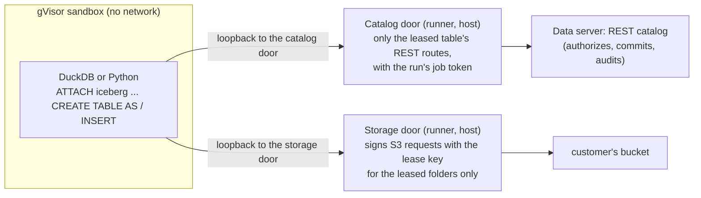

# Proposal 0005: the write path on compute

Status: proposed 13 Nov 2026, for Codex's review. Part of the beta (workstream W7 in [0003](0003-beta.md)).
**Built (13 and 14 Nov):** the job's `table_writes`, the narrowed token, write credentials in the lease, both doors, and `POST /imports`
from a volume file or an `https://` address (`runner/src/fetch.rs`) with modes create, append and replace; compaction and snapshot
expiry through `POST /tables/{id}/maintenance`, and schedules for either action; the console's import dialog. All proven in gVisor
against RustFS by `scripts/compute-smoke.py`. **Not built yet:** import from an S3 location (a signed https address already works).

## Context

Today only an outside DuckDB client can write an Iceberg table: it attaches our REST catalog, is handed short-lived credentials, writes
Parquet to the bucket itself and commits through the catalog (`loamz import`, `scripts/nyc_week.py`). Compute that we orchestrate
cannot: a sandbox has no network and its statements are read-only. For the beta, a customer must be able to bring data in from the
console (a file, an S3 location, a URL) and keep tables in shape (compaction, snapshot expiry), and a job must be able to write a
table. All of that runs on the customer's own machines.

## Decision

**One mechanism: a run may declare tables it writes, and its sandbox is given two narrow doors.** Import, compaction and expiry are
system-authored jobs that use it; a customer's own job can use it too. Nothing new is trusted: the sandbox still has no network and
no key.

1. **The run declares its writes.** The job spec gets `writes: [table ids]` (the existing `reads` and `writes` of a run token cover
   volumes today; tables are added). The server authorizes `MODIFY` (or `CREATE TABLE` for a new one) on each and narrows the job
   token to exactly those tables' catalog routes. A table with row or column rules cannot be written by someone the rules apply to.
2. **The catalog door.** A loopback port in the sandbox forwards to one Unix socket on the host; the runner's door forwards only
   `GET`, `POST` and `HEAD` for `/api/v1/workspaces/{ws}/iceberg/v1/...` paths of the leased tables to the Data server, adding the job
   token. The sandbox never sees the token or the server's address. Any other path is refused.
3. **The storage door.** The existing broker grows a second mode for a write lease: a signing proxy. It accepts the S3 requests DuckDB
   makes (`PutObject`, the multipart calls, `DeleteObject`, `GetObject`, `HeadObject`, `ListObjectsV2` limited to a leased prefix),
   checks method, path and query against the lease, re-signs with the lease's credentials (SigV4, as `loamz-lake` already does) and
   forwards to the real endpoint. The signature DuckDB made is ignored. Writes are allowed only under the leased tables' folders.
4. **No vended credentials inside the sandbox.** DuckDB is told not to use the catalog's vended credentials
   (`ACCESS_DELEGATION_MODE 'none'`) and is given a placeholder secret whose endpoint is the storage door.
5. **The write lease is as short as the run,** and the credentials behind the storage door are the ones the server vends for those
   folders with write access, cached the same way.
6. **Import.** The console (or SDK) creates a volume file or names a source. The server queues an `import` job: target table, mode
   (create, append, replace), format (CSV, Parquet), the source. For a source that is a volume file, the job token reads it through the
   existing file route. For an S3 location or a URL, **the runner fetches it before the sandbox starts**, into the run's input folder,
   with these rules: HTTPS only, no redirects to private or link-local addresses, a size cap, a time cap. The sandbox then runs a
   fixed script we write (`read_csv` or `read_parquet` into the attached table); no customer SQL is involved.
7. **Compaction and snapshot expiry** are fixed system jobs on demand or on a schedule. Compaction runs DuckDB's rewrite in a
   transaction and commits only when row count and an order-independent content checksum are unchanged. Expiry commits removal of
   snapshots older than the requested window, while keeping the current snapshot and every snapshot named by a ref; it removes only
   data and manifest objects that those removed snapshots referenced and that no retained snapshot uses. Both actions use the normal
   `MODIFY` and row/column-rule checks at schedule creation and again when the schedule fires. An interrupted expiry may leave
   unreferenced objects, but cannot make a retained snapshot point at a deleted object.

## Why not the alternatives

- **Run DuckDB on the host for imports.** Fast and simple, but it parses untrusted files outside the sandbox. Rejected.
- **Write Parquet and manifests ourselves in Rust.** We would own an Iceberg writer. DuckDB's is already what customers use.
- **Let the sandbox have network access limited to two hosts.** gVisor's network filtering is coarser and the doors give one place
  to enforce and audit everything.

## Threats to check in review

A malicious file (the parser is DuckDB in gVisor: memory and time are capped); a job writing outside its folders (the door checks
every path); a job committing to another table (the catalog door allows only the leased tables); a slow or hung door; request
smuggling through the signing proxy (it parses and re-emits; it never passes headers through); an import used to fetch from internal
addresses (the runner's fetch rules); a crash between the data write and the commit (orphan files, cleaned by expiry); a retry
committing twice (the commit carries the run id and the catalog rejects a second one).

## Plan

Contracts first (the job spec's `writes`, the door routes, the import route and its OpenAPI), then one write batch: the storage door,
the catalog door, the server's `writes` and import route, the runner wiring, the SDK and console hooks; then one integration pass.
