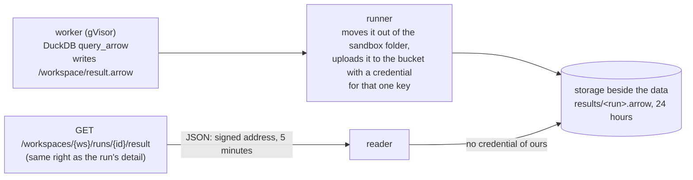

# Proposal 0006: large results as Arrow

Status: first part built 14 Nov 2026 (the Arrow file and its signed link); the agent-sandbox part is planned below.

## Problem

A statement's rows come back as JSON text, kept in the run and capped at 4 MiB (about 10,000 rows). That is fine for the console and
not for a script, a notebook or a BI tool. JSON also loses types (a decimal is a string) and costs both ends time. The principle:
keep data where it lives, move only what is needed, and never through the Data server.

## Built: the whole result as an Arrow file beside the data

`POST /sql/statements` with `"export": true` keeps the whole result as an Arrow IPC stream file.

- The statement is guarded and rewritten as today. With `export`, the run's JSON result has the columns and `export: {rows, bytes}`.
- The worker writes the file with its own calls (DuckDB's external access stays off), stops at 1 GiB, and removes it on error.
- The runner puts the file in the same store and location as the first table, under `results/`, with a write credential for that one
  key (the tables' credentials stay read-only). A failed upload fails the run. The Data server never carries the bytes.
- The server only authorizes and signs. A statement needs at least one table, and a storage that can sign.
- Files are removed 24 hours after the run ends, or at once for an erased run.

## Planned: agent sandboxes read storage through the broker

Agents' code runs in a gVisor sandbox on Loamz compute, with no network and no credentials. It reads the person's files and query
results as `s3://` paths through the runner's existing read-only storage broker (ranged reads, host cache, only the leased
folders), so Polars, DuckDB and pyarrow fetch only the bytes they touch. Query results become immutable Parquet objects at
`threads/<thread>/results/<run>.parquet`. `/workspace` is local scratch; files written under `/workspace/out/` are committed to
`threads/<thread>/files/` at the end, with conditional writes, and the run says which were committed. One active run per thread,
enforced in the database with fencing. No FUSE and no staging of whole folders; FUSE stays an optional later adapter. Before
building: a spike measuring range reads, cache correctness, credential isolation and Polars/DuckDB/pyarrow compatibility against
RustFS, cold and warm.

## Threats to check

A link for someone without the run's detail right; a file left after erase or expiry; a runner writing outside its one key; a worker
filling the disk (capped, removed after each statement); a statement writing other files (external access stays off).
