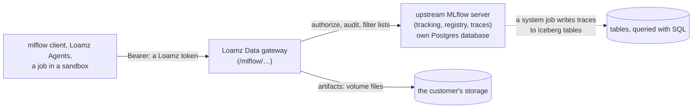

# Proposal 0008: the AI phase

Status: proposed 14 Nov 2026, for Codex's review. Workstream W12 in [0003](0003-beta.md). The owner has confirmed that all of it is in the
beta: functions as agent tools, agent sandboxes, MLflow for ML and for GenAI, and Loamz Agents sending its traces and evaluations to
Loamz Data.

## What the beta must do

1. **Agent sandboxes** (partly built, proposal 0006): code an agent writes runs in gVisor on Loamz compute, reads the person's data in place,
   commits what it makes, and has no network or key.
2. **Functions as agent tools:** a SQL or Python function is a governed object; an agent calls it as a tool and it runs in a sandbox, as
   the caller, with no more access than they have.
3. **MLflow for ML:** experiments, runs, metrics, artifacts and a model registry, with the standard `mlflow` client and no custom SDK, for the pinned client operations that pass the compatibility gate below.
4. **MLflow for GenAI:** traces, evaluations and prompts (versioned, with aliases) with the standard client. Loamz Agents sends its traces
   there, loads its prompts from there and runs its evaluations against it.
5. All of it under the same grants, audit and storage as a table: nothing is readable by someone who could not read the data.

## Decision

**Run the upstream MLflow server as a managed component, and put a governing gateway in front of it. Do not reimplement MLflow.**

- **Identity:** the client sends `MLFLOW_TRACKING_TOKEN`, a Loamz access token (a person's, a service principal's, or a job's narrowed
  token). The gateway checks it with the code the HTTP API uses. MLflow itself is never reachable except through the gateway.
- **Objects are securables.** An experiment, a registered model and a prompt are catalog objects with three-part names
  (`catalog.schema.name`, as MLflow's Unity Catalog registry already names models and prompts), so grants, ownership, inheritance,
  search, drop and erase can be enforced as for tables. Three-part names alone do not implement the Unity Catalog protocol. Privileges: reading needs `SELECT`, writing `MODIFY`, creating `CREATE` on the schema,
  calling a function `EXECUTE`. The gateway keeps the map from an MLflow id to its securable.
- **The gateway is an allow-list.** It forwards the endpoints the standard client uses for tracking, the registry, traces, evaluations
  and prompts, after resolving which securable a request is about; it restricts searches, counts, ordering and paging to what the caller may see before these are computed;
  it audits creates, changes and deletes. An endpoint it does not know is refused (404), so a new MLflow release cannot open a hole.
- **Artifacts** (model files, run files, evaluation outputs) do not go to a bucket MLflow holds keys for. The gateway implements MLflow's
  small artifact API over volumes: each experiment and model has a volume folder, written with the same checks and storage as any file,
  so customer bytes stay in the customer's storage under their credential.
- **Traces** arrive by MLflow's OTLP endpoint and the tracking API. A system job may mirror them into Iceberg
  tables only when those tables enforce the same per-trace source policies, including row filters and masks.
- **Functions** are a securable kind: a SQL function (a parameterized `SELECT`) or a Python function (a script and its declared inputs).
  `GET /functions` lists the callable ones as tool schemas, and `POST /functions/{id}/call` runs one as a job (reads and commits as in
  0006) under the caller's identity and returns its result. Loamz Agents turns that list into tools.
- **Where MLflow runs:** next to the Data server on the managed host, as its own service with its own database; its deployment is a role
  in `loamz-deploy`. A customer who runs their own compute still talks to the same gateway.

## Why not the alternatives

- **Implement MLflow's API in Rust:** the surface is large and moves with every release (traces and evaluations change fastest); the
  standard client would break first.
- **Run MLflow beside us without governance:** two permission systems, artifacts in a bucket the product does not own, nothing audited.
- **Only OpenTelemetry for traces:** no registry, evaluations or prompts, and the client could not be pointed at it.

## Loamz Agents integration

- Its OpenTelemetry tracing (`kernel/telemetry`) exports to the gateway's OTLP endpoint with the person's exchanged token, so a trace is
  the person's and visible only as grants allow.
- Prompts are loaded by name and alias (`prompts:/catalog.schema.name@alias`).
- Evaluations (`mlflow.genai.evaluate`) run as jobs in a Loamz sandbox, read their dataset from a table and write results as tables and
  MLflow runs.
- The data tools and the code-interpreter switch (0006) are the other half of the integration.

## Threats to check in review

An id guessed across workspaces or organizations (the gateway's id map must scope every lookup); a list or search that returns an object
the caller may not see, in its rows, counts or paging; a trace that carries prompt text or data to someone without a right to the table it
was about; a model artifact (pickle) run by a reader (artifacts are never loaded by the server; code that loads one runs in a sandbox); an
OTLP flood (rate limits per person, and a size cap); the gateway forwarding a header or path MLflow treats as trusted (it forwards nothing
but what it builds); a function that reaches other data than the caller's; MLflow's own user model being used instead of ours (it is
disabled).

## Plan

1. Contracts: the securable kinds and privileges, the gateway's endpoint allow-list, the artifact API over volumes, OpenAPI.
2. Gateway and id map for tracking and the model registry; the managed MLflow service and its deploy role.
3. Traces, the OTLP endpoint and the mirror to tables; prompts and evaluations.
4. Functions: the securable, the tool list and the call.
5. Loamz Agents: tracing export, prompt loading, evaluation jobs, function tools (Antigravity, against the contracts).
6. Console: experiments, models, prompts and functions in the catalog screens; search covers them.
7. One integration pass: the standard client end to end, then a hostile review round (Copilot) and Codex's final pass.

## Review amendments and release gates

The security and architecture review is in [notes/0008-review.md](../../notes/0008-review.md). These amendments qualify the design above:

1. **Authorize the whole object graph.** Bind every ID, name, alias and reference to the organization and workspace; resolve and authorize every member of a batch and each source and destination against current grants and trusted provenance. Hide missing and forbidden alike. Bind opaque paging tokens to the caller, workspace, query and authorization epoch. If a search, count or aggregate cannot be scoped before it is computed, use an authorized index or refuse it.
2. **Source policies follow derived data.** Require access to the MLflow object and all its source data on every read, including artifacts, trace searches and mirrors. Preserve row filters and masks; where equivalent restrictions cannot be enforced, deny access. Unknown provenance stays private to the creator and unavailable to others. Recheck on policy change and revocation.
3. **Pin the contract, deny by default.** The review lists candidate tracking, registry, prompt, trace, assessment, evaluation and artifact API families; enumerate exact methods and paths from a pinned standard client and test each. A UC-configured client uses a distinct protocol that must be implemented and proven separately, or its mode must be documented as unsupported. Disable all other endpoints, direct upstream access, arbitrary URLs and upstream presigned or multipart credentials. Do not claim blanket standard-client compatibility.
4. **Treat artifacts as hostile.** The gateway owns volume paths and implements artifact transfers; normalize and constrain paths, reject traversal and symlinks, stream with file, expansion, storage and concurrency limits, and clean up partial writes. Never load model files in the server. Loading pickle and other executable artifacts requires an isolated caller-authorized job; warn users.
5. **Minimize traces.** Content capture is opt-in and off by default. Reject secrets, tokens, credentials, authorization headers, cookies and connection strings before storage or forwarding; structured allow-listing and redaction are required, and uncertain payloads fail closed. Never rely on redaction to make arbitrary free text safe. Trusted data-access events establish provenance, not client-supplied OTLP tags. Apply retention and durable erasure to every copy.
6. **Functions cannot elevate.** EXECUTE only permits a call; all input and output access is the intersection of the caller's current rights, agent rights and a narrowly scoped job. Reject undeclared access and recheck at submission, lease, access and result retrieval. Run in fresh gVisor with no network or host credentials; initial ceilings are 60 seconds, 1 GiB memory, 4 MiB returned output and 1 GiB scratch, plus CPU, process, log and organization quotas. Operators may lower limits; higher limits need reviewed configuration.
7. **Finish the operational boundary before the first customer.** Loamz and MLflow databases cannot share a transaction: use durable audited operation states, idempotent retries and reconciliation, fail-closed visibility, consistent backup/restore, and durable drop and erase. Prove cross-tenant isolation, policy changes, crash recovery, malicious artifacts, abuse limits and the pinned client end to end. A sandbox without network cannot call an external judge or gateway: define a narrowly scoped broker and approved egress, or support local evaluators only. Finish and test the relevant 0005/0006 dependencies first.

## Principle check (14 Nov): governance decides, compute and storage move the bytes

The README's picture says the catalog never carries data. Two places in this phase would break that, and are decided here:

1. **MLflow artifacts: the gateway authorizes and redirects; it does not carry bytes.** An artifact download or upload (`/api/2.0/mlflow-artifacts/artifacts/...`) is resolved to its mapped run or model, checked, and answered with a redirect (307) to a short-lived signed address into the customer's storage, so the bytes go from the client to the bucket. A spike (`bench/mlflow_contract.py` extended) must show that the pinned stock client follows a 307 on `PUT` and `GET`. If it cannot, the fallback is a bounded pass-through in the gateway (256 MiB per file, streamed, with the limits in the review), recorded as an exception in `docs/architecture/decisions.md`.
2. **The BI connection (0007) is a recorded exception today.** Flight SQL clients expect the data on a Flight endpoint, so the Data server streams the result batches that compute kept in storage. It is read-only, authorized as the caller, and capped; the way out is delivering the result file by a signed address once the clients we support accept it.

Everything else here follows the picture: a function or an evaluation runs on compute as the caller, a trace mirror is a job writing tables with its own credential, and the gateway only decides.

