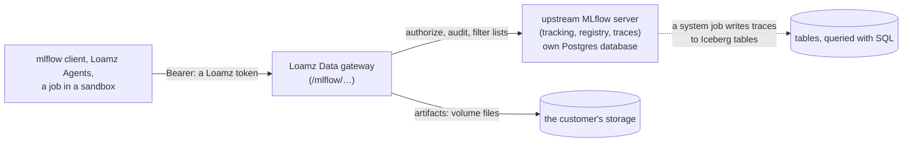

# Proposal 0008: the AI phase

Status: proposed 14 Nov 2026, for Codex's review. Workstream W12 in [0003](0003-beta.md). The owner has confirmed that all of it is in the
beta: functions as agent tools, agent sandboxes, MLflow for ML and for GenAI, and Loamz Agents sending its traces and evaluations to
Loamz Data.

## What the beta must do

1. **Agent sandboxes** (built, proposal 0006): code an agent writes runs in gVisor on Loamz compute, reads the person's data in place,
   commits what it makes, and has no network or key.
2. **Functions as agent tools:** a SQL or Python function is a governed object; an agent calls it as a tool and it runs in a sandbox, as
   the caller, with no more access than they have.
3. **MLflow for ML:** experiments, runs, metrics, artifacts and a model registry, with the standard `mlflow` client and no custom SDK.
4. **MLflow for GenAI:** traces, evaluations and prompts (versioned, with aliases) with the standard client. Loamz Agents sends its traces
   there, loads its prompts from there and runs its evaluations against it.
5. All of it under the same grants, audit and storage as a table: nothing is readable by someone who could not read the data.

## Decision

**Run the upstream MLflow server as a managed component, and put a governing gateway in front of it. Do not reimplement MLflow.**

- **Identity:** the client sends `MLFLOW_TRACKING_TOKEN`, a Loamz access token (a person's, a service principal's, or a job's narrowed
  token). The gateway checks it with the code the HTTP API uses. MLflow itself is never reachable except through the gateway.
- **Objects are securables.** An experiment, a registered model and a prompt are catalog objects with three-part names
  (`catalog.schema.name`, as MLflow's Unity Catalog registry already names models and prompts), so grants, ownership, inheritance,
  search, drop and erase work as for tables. Privileges: reading needs `SELECT`, writing `MODIFY`, creating `CREATE` on the schema,
  calling a function `EXECUTE`. The gateway keeps the map from an MLflow id to its securable.
- **The gateway is an allow-list.** It forwards the endpoints the standard client uses for tracking, the registry, traces, evaluations
  and prompts, after resolving which securable a request is about; it filters what lists and searches return to what the caller may see;
  it audits creates, changes and deletes. An endpoint it does not know is refused (404), so a new MLflow release cannot open a hole.
- **Artifacts** (model files, run files, evaluation outputs) do not go to a bucket MLflow holds keys for. The gateway implements MLflow's
  small artifact API over volumes: each experiment and model has a volume folder, written with the same checks and storage as any file,
  so customer bytes stay in the customer's storage under their credential.
- **Traces** arrive by MLflow's OTLP endpoint and the tracking API. A system job (the write path, proposal 0005) mirrors them into Iceberg
  tables so they can be queried with SQL and joined with the data they were about.
- **Functions** are a securable kind: a SQL function (a parameterized `SELECT`) or a Python function (a script and its declared inputs).
  `GET /functions` lists the callable ones as tool schemas, and `POST /functions/{id}/call` runs one as a job (reads and commits as in
  0006) under the caller's identity and returns its result. Loamz Agents turns that list into tools.
- **Where MLflow runs:** next to the Data server on the managed host, as its own service with its own database; its deployment is a role
  in `loamz-deploy`. A customer who runs their own compute still talks to the same gateway.

## Why not the alternatives

- **Implement MLflow's API in Rust:** the surface is large and moves with every release (traces and evaluations change fastest); the
  standard client would break first.
- **Run MLflow beside us without governance:** two permission systems, artifacts in a bucket the product does not own, nothing audited.
- **Only OpenTelemetry for traces:** no registry, evaluations or prompts, and the client could not be pointed at it.

## Loamz Agents integration

- Its OpenTelemetry tracing (`kernel/telemetry`) exports to the gateway's OTLP endpoint with the person's exchanged token, so a trace is
  the person's and visible only as grants allow.
- Prompts are loaded by name and alias (`prompts:/catalog.schema.name@alias`).
- Evaluations (`mlflow.genai.evaluate`) run as jobs in a Loamz sandbox, read their dataset from a table and write results as tables and
  MLflow runs.
- The data tools and the code-interpreter switch (0006) are the other half of the integration.

## Threats to check in review

An id guessed across workspaces or organizations (the gateway's id map must scope every lookup); a list or search that returns an object
the caller may not see, in its rows, counts or paging; a trace that carries prompt text or data to someone without a right to the table it
was about; a model artifact (pickle) run by a reader (artifacts are never loaded by the server; code that loads one runs in a sandbox); an
OTLP flood (rate limits per person, and a size cap); the gateway forwarding a header or path MLflow treats as trusted (it forwards nothing
but what it builds); a function that reaches other data than the caller's; MLflow's own user model being used instead of ours (it is
disabled).

## Plan

1. Contracts: the securable kinds and privileges, the gateway's endpoint allow-list, the artifact API over volumes, OpenAPI.
2. Gateway and id map for tracking and the model registry; the managed MLflow service and its deploy role.
3. Traces, the OTLP endpoint and the mirror to tables; prompts and evaluations.
4. Functions: the securable, the tool list and the call.
5. Loamz Agents: tracing export, prompt loading, evaluation jobs, function tools (Antigravity, against the contracts).
6. Console: experiments, models, prompts and functions in the catalog screens; search covers them.
7. One integration pass: the standard client end to end, then a hostile review round (Copilot) and Codex's final pass.
