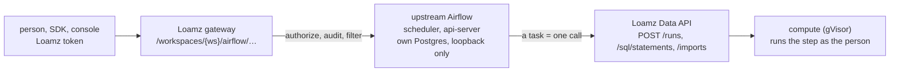

# Proposal 0009: workflows with Apache Airflow

Status: proposed 14 Nov 2026, for Codex's review. Workstream W15 in [0003](0003-beta.md). The owner expects job orchestration to be
Airflow, integrated the way MLflow is (0008).

## What the beta must do

A person defines a **pipeline**: several steps (a SQL statement, a Python job, an import, table maintenance) with dependencies, a
schedule or a manual trigger, retries, and a history of runs. They see its runs and logs, trigger it, pause it, and are alerted when it fails.
Every step runs as them, with no more access than they have, on compute in the customer's own account, in gVisor.

## Decision

**Run upstream Airflow as a managed component that only orchestrates, behind a Loamz gateway that decides. The code of a step never runs in Airflow.**

- **A pipeline is a catalog object** (`pipeline`, named `catalog.schema.name`): grants, hiding, ownership, drop and erase work as for a table.
  Reading needs `SELECT`, editing `MODIFY`, creating `CREATE_PIPELINE`, triggering and pausing `EXECUTE`.
- **A pipeline is data, not Python.** Its definition is a small JSON document (steps, what each runs, dependencies, retries, schedule),
  validated by the server and kept in the catalog. One trusted DAG file that we ship reads the definitions and builds the DAGs. People
  never upload Airflow DAG code: that would run arbitrary Python on the control plane.
- **A step is one Loamz call.** The shipped operator (`LoamzStep`) submits the step through the Data API as the pipeline's owner,
  narrowed to what the step declares, waits for the run, and returns its state. Rights are re-checked at every run, as for schedules
  (0003 W8): a pipeline whose owner lost access pauses instead of running with old rights.
- **The gateway is an allow-list over Airflow's REST API:** list and get pipelines, trigger, pause and resume, list and get runs and
  task instances, clear and cancel a run. Never forwarded: connections, variables, pools, configuration, plugins, providers, users and
  roles, the UI, and anything unreviewed. Task logs are not Airflow's: a run's output is what the Loamz run API already returns under the
  same rights. Airflow's own login is internal only: the gateway holds one service credential (in `OpenBao`), the caller never sees it.
- **Names:** Airflow's DAG id is `<workspace id>.<catalog.schema.name>`, so two workspaces can use the same name.
- **Alerts:** the failure alert of 0003 W8 (a webhook held in the vault) is reused: a failed pipeline run writes the same alert row.
- **Schedules stay.** Simple cron and interval jobs (built, W8) keep working; a pipeline is for several steps. Later, a schedule can be
  stored as a one-step pipeline.

## Why not the alternatives

- **Let people write DAG files:** Python on the Airflow host with its database and credentials; one bad import breaks every tenant.
- **Build our own workflow engine:** dependencies, retries, backfills and run history are what Airflow already does well; we would own
  all of its bugs, and users expect Airflow.
- **Airflow's own Kubernetes or Docker operators:** they would run customer code outside our sandbox and compute placement.

## Threats to check in review

A DAG id or run id of another workspace; a definition that makes the shared DAG file run code or read files (the factory only reads
validated JSON); a step that submits as someone else (the owner is fixed at save and rechecked at run); the operator's credential
leaking into task logs or XCom; a flood of triggers or backfills (caps per pipeline and per workspace, a max active runs); the gateway
forwarding a header or path Airflow treats as trusted; a pipeline kept running after its owner is erased; two databases that cannot
share a transaction (the same operation-state rules as 0008); Airflow's UI or API reachable around the gateway.

## Plan

1. Contracts: the `pipeline` kind and its privileges, the definition's JSON schema and limits, the gateway's allow-list recorded from
   a pinned Airflow's real traffic (as `docs/design/mlflow-contract.md` was), OpenAPI.
2. The gateway, the id map, the shipped DAG factory and `LoamzStep` operator, and the managed Airflow's deploy role in `loamz-deploy`.
3. Triggers, pause and resume, run history, alerts; drop and erase of a pipeline durable across both databases.
4. Console: pipeline screens (definition, runs, trigger, pause); SDK: `loamz pipelines`.
5. One integration pass with the stock Airflow client, then a hostile review round and Codex's final pass.
