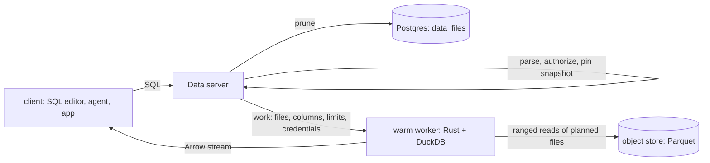

# 001 Fast data plane: design

## High level

| Tier | Format | Why |
|---|---|---|
| object store | Parquet | network bytes dominate; compressed, column chunks, stats |
| engine | DuckDB vectors | fixed by the engine |
| wire | Arrow IPC stream | no per-value encoding; read by arrow-js without parsing |

**Fallbacks (slower, never wrong):** a snapshot with delete files, or a predicate the planner cannot evaluate, is read with
`iceberg_scan`. A cache miss reads from the store.

## Low level

**`data_files` (migration, Postgres and SQLite):** `table_id, snapshot_id, path, content (data | position_deletes | equality_deletes),
spec_id, schema_id, record_count, file_size, partition (by field id), column stats (by field id: min, max, nulls)`.
Written in `storage/tables/service.rs::commit` inside the same `Uow` as `catalogs::advance` and the audit entry: the commit reads the new
snapshot's manifests (as `column_stats` already does) and inserts their rows. If manifests cannot be read, the commit is refused.
Expired snapshots delete their rows in the same task that expires them.

**Planning (`compute/sql.rs` + `storage/tables`):** from the parsed statement, take the projected columns and simple predicates
(`=`, `<`, `>`, `BETWEEN`, `IN` on a column); select the snapshot's `data` rows whose partition and stats can match.

**Work request (server → worker), versioned:** `{v: 1, run_id, attempt, sql, tables: [{name, snapshot_id, files | iceberg_metadata}],
limits: {cpu, memory_mb, timeout_s}, credentials, result: arrow}`. Same document for a machine (pull) and Modal (push).

**Worker (`server/runner`):** embeds DuckDB (`duckdb` crate); one pool per (tenant, trust scope); a worker is recycled after N
statements, an idle period or any error; `threads` = granted cores; DuckDB's HTTP, Parquet metadata and file caches on.
Deleted: `work.rs::fetch_table`, `sandbox/run_sql.py`, `sandbox/loamz_sql.py`, the JSON result path.

**Modal:** the worker image deployed as a Modal Server; a short Python file only for its region and limits.

## Edge cases
Schema evolution (stats by field id, not name) · partition evolution (`spec_id`) · crash after the metadata file is written but before the
transaction (orphan file, removed by expiry) · concurrent commits (existing compare-and-set) · empty tables · cancellation mid-stream.
